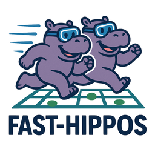
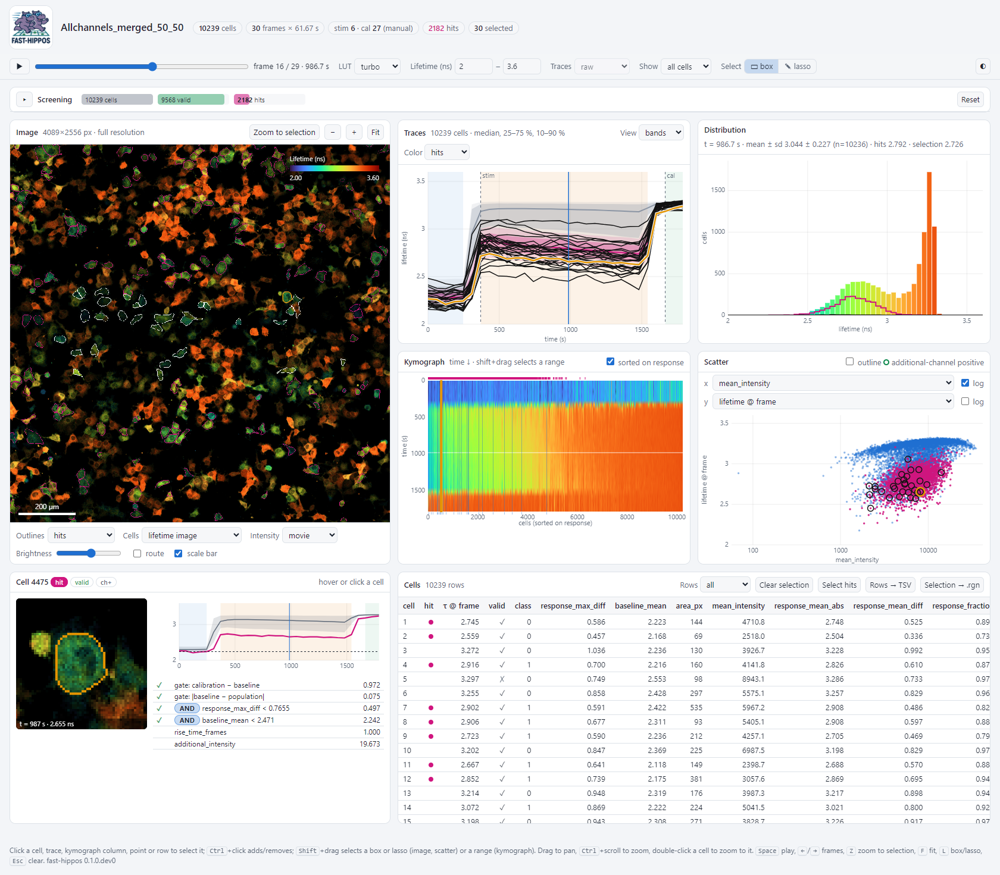
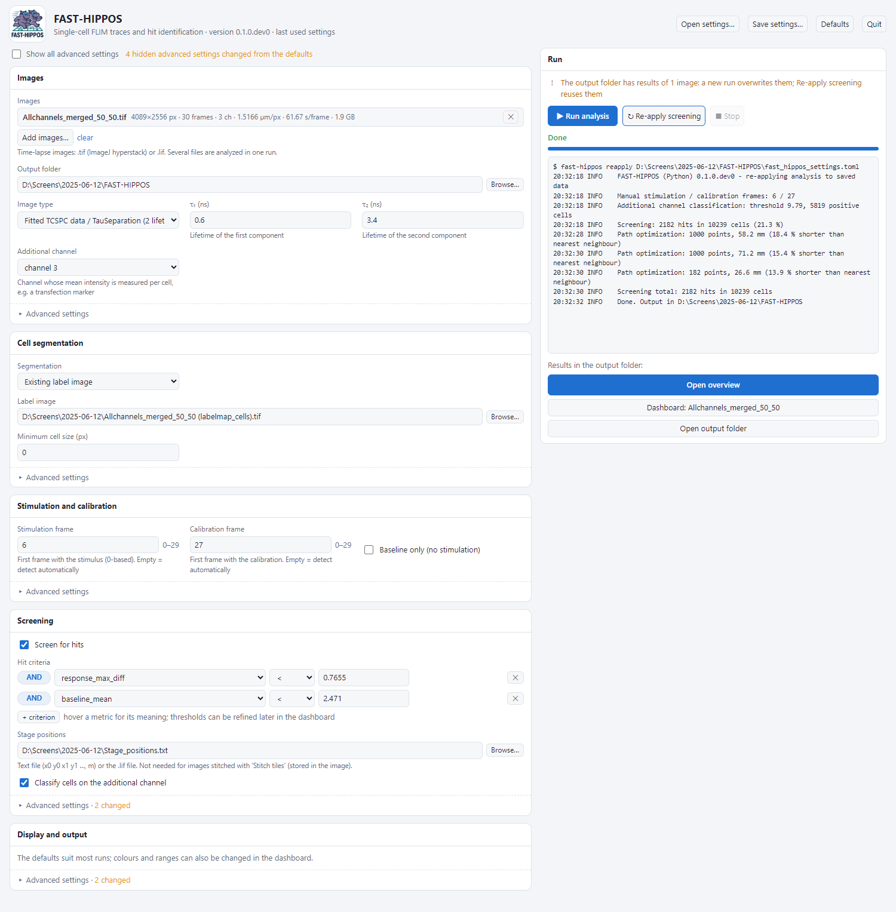
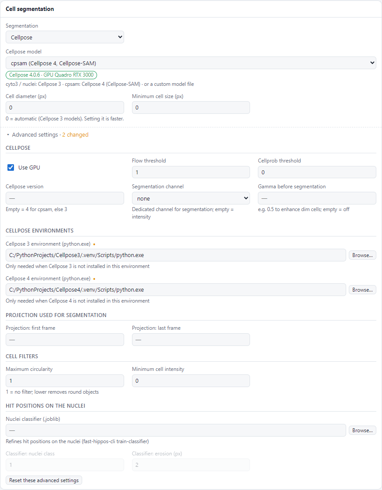
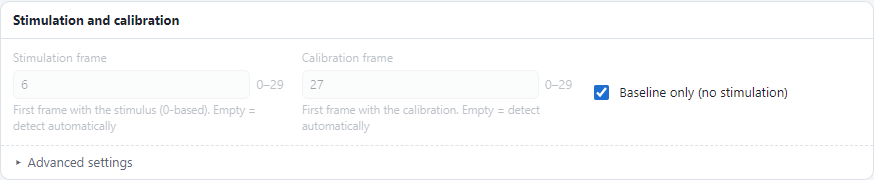
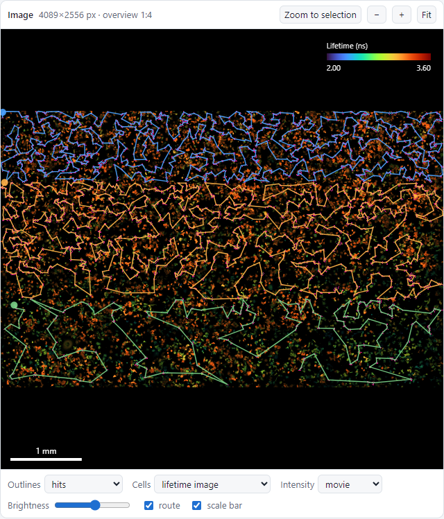
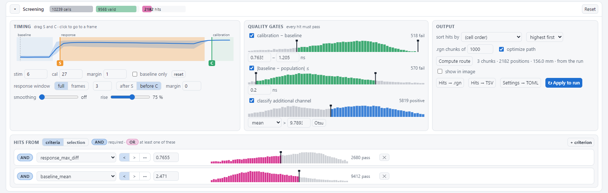
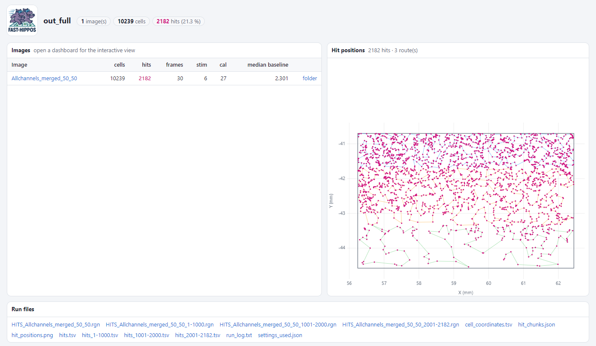

<p align="center">
  
</p>

<h1 align="center">FAST-HIPPOS for Python</h1>

<p align="center">
  <b>F</b>LIM <b>A</b>nalysis of <b>S</b>ingle-cell <b>T</b>races for <b>H</b>it <b>I</b>dentification of
  <b>P</b>henotypes in <b>P</b>ooled <b>O</b>ptical <b>S</b>creening
</p>

<p align="center">
  
</p>

> [!WARNING]
> **Unverified test version.** This Python version is under development and has not yet been validated for
> production screening. Results, settings and file formats may change. For experiments, use the
> [FAST-HIPPOS Fiji plugin](https://imagej.net/plugins/fast-hippos), or check the results carefully against it.

FAST-HIPPOS analyzes multi-cell time-lapse experiments. It segments the cells, measures a fluorescence lifetime
(or ratio, or intensity) trace for every cell, and finds the cells that show the kinetic behaviour you are looking
for. Their stage coordinates are written as Leica LAS X `.rgn` files, so that the microscope can revisit exactly
those cells for photoactivation, high-resolution imaging, FRAP, and so on. Outside screening, it is a convenient
tool for single-cell trace analysis, visualization and inspection.

This is the Python version of the [FAST-HIPPOS Fiji plugin](https://imagej.net/plugins/fast-hippos)
([GitHub](https://github.com/Jalink-lab/FAST-HIPPOS)). It follows the workflow of the Fiji macro v0.9.5, with a
graphical interface in the browser and **one interactive dashboard per image** instead of many image windows and
tables. In the dashboard you can change the hit criteria after the analysis and see the result immediately.

<p align="center">
  
  <br><sub>Dashboard of a stitched 4089 × 2556 px, 30-frame TCSPC screen with 10 239 cells, zoomed in on a selection
  of hits. All views are linked: the cell under the mouse (yellow) is highlighted in the image, the traces, the
  kymograph, the scatter plot and the cell card.</sub>
</p>

## Contents

- [What it does](#what-it-does)
- [Installation](#installation)
- [The graphical interface](#the-graphical-interface)
- [The dashboard](#the-dashboard)
- [Changing the hit criteria after the analysis](#changing-the-hit-criteria-after-the-analysis)
- [Analysis details](#analysis-details)
- [Command line and settings files](#command-line-and-settings-files)
- [Output files](#output-files)
- [Speed and large images](#speed-and-large-images)
- [Differences from the Fiji version](#differences-from-the-fiji-version)
- [Development](#development)

## What it does

| Step | |
|---|---|
| **Input** | Multi-channel time-lapse `.tif` files (ImageJ hyperstacks), Leica `.lif` files, or folders of tiles exported from LAS X (stitched by their stage positions); several images per run. Fitted two-component TCSPC data (LAS X lifetime components / TauSeparation), Fast FLIM, TauContrast, frequency-domain FLIM, ratio imaging, or intensity only. An optional additional channel, e.g. a transfection marker, is measured per cell. |
| **Pre-processing** | Optional correction of the bidirectional-scanning phase and of drift. |
| **Segmentation** | Cellpose 3 or Cellpose 4 (Cellpose-SAM), on the GPU when available, of a projection of (part of) the time-lapse. Or an existing label image, or a threshold with watershed. Cells can be filtered on size, circularity and intensity. |
| **Traces** | Lifetime (or ratio, or intensity) and intensity of every cell in every frame. For TCSPC the fitted amplitudes of all pixels of a cell are pooled. |
| **Stimulation and calibration** | Detected automatically in the population trace, or set by hand, or 'baseline only'. Traces are split into baseline, response and calibration. |
| **Screening** | Per-cell metrics, quality gates, classification on the additional channel, and any number of hit criteria that must all pass (AND) or of which one must pass (OR). Alternatively hand-picked hits. |
| **Hit positions** | Stage coordinates of the hits, optionally refined on the nuclei with a pixel classifier, in `.rgn` files of up to 1000 positions, each with an optimized visiting route. |
| **Results** | An interactive dashboard per image, an overview page of the run with a map of all hit positions, tables and TIFF images. |

## Installation

FAST-HIPPOS needs Python ≥ 3.12. Installing with [uv](https://docs.astral.sh/uv/) is recommended:

```powershell
git clone https://github.com/Jalink-lab/FAST-HIPPOS-Python.git
cd FAST-HIPPOS-Python
uv sync                         # creates .venv with all dependencies
uv sync --extra lif             # optional: read Leica .lif files
uv run fast-hippos-cli shortcut # optional (Windows): a desktop shortcut with the FAST-HIPPOS logo
```

> If the project folder is in a synchronized folder (OneDrive, SURFdrive, Dropbox), keep the environment out of
> it: set `$env:UV_PROJECT_ENVIRONMENT = "D:\envs\FAST-HIPPOS\.venv"` (any local, non-synchronized folder)
> before calling `uv`.

This installs two programs in the environment's `Scripts` folder:

| Program | |
|---|---|
| `fast-hippos.exe` | the graphical interface, in the browser, without a console window (also behind the desktop shortcut) |
| `fast-hippos-cli.exe` | the command line; without a command it opens the graphical interface as well |

**Cellpose.** Cellpose does not have to be installed in this environment. FAST-HIPPOS can use existing Cellpose 3
and Cellpose 4 environments (set their `python.exe` in the interface, under *Cell segmentation → Advanced
settings*), and runs Cellpose there, on the GPU if PyTorch with CUDA is installed. To install Cellpose in this
environment instead, use `uv sync --extra cellpose3` or `uv sync --extra cellpose4`.

## The graphical interface

Double-click the desktop shortcut (or `fast-hippos.exe`). The interface opens in your web browser.

<p align="center">
  
  <br><sub>The interface after re-applying the screening to a finished run. Right: the checks before running, the
  log, and buttons to open the results.</sub>
</p>

A typical run:

1. **Images**: *Add images…* (or *Add tile folder…*, see [Stitching tiles](#stitching-tiles)) and choose the output folder. Each image shows its size, number of frames and
   channels, pixel size, frame interval and whether its stage positions are stored in it. Choose the image type,
   τ₁ and τ₂ for TCSPC data, and the additional channel, if any.
2. **Cell segmentation**: Cellpose with a model (`cyto3`, `nuclei`, `cpsam` or your own), or an existing label
   image. The interface checks the Cellpose environment and shows its version and GPU.
3. **Stimulation and calibration**: leave the frames empty for automatic detection, set them, or choose *Baseline
   only*.
4. **Screening**: switch it on and add hit criteria. Stage positions are read from the images themselves (see
   below); only images without them need a *Stage positions file* (advanced settings).
5. **Run analysis**. The log shows the progress; when the run is done, *Open overview* and *Dashboard* open the
   results.

**Basic and advanced settings.** Each section shows the settings needed for a typical run. All other settings
are in an expanding *Advanced settings* pane per section, grouped under subheadings; *Show all advanced settings*
opens all of them. Changed advanced settings are marked, and the note at the top tells how many hidden settings
differ from the defaults, so that nothing changes unnoticed.

<p align="center">
  
  <br><sub>Cell segmentation with its advanced settings: Cellpose 4 found, with GPU.</sub>
</p>

**Settings that do not apply are greyed out**, with the reason as tooltip: for instance the stimulation and
calibration frames with *Baseline only*, the screening settings when screening is off, the drift options without
drift correction, or the classification settings without an additional channel.

<p align="center">
  
</p>

**Checks before a run.** Problems that would stop a run (no images, a missing label image, Cellpose not found,
calibration before stimulation, frames beyond the end of the movie, a criterion without a value) disable *Run
analysis*. Warnings point out other surprises: no stage positions means no `.rgn` files, the output folder already
holds results, Cellpose will run on the CPU.

**Re-apply screening** redoes event detection, screening, the hit lists, the `.rgn` files and the dashboards for
the results in the output folder, without segmentation and measurement: seconds instead of minutes. Use it after
changing the screening settings.

**Settings files.** The interface remembers the last used settings. Every run also saves its settings in the
output folder as `fast_hippos_settings.toml`; *Open settings…* loads such a file (or any FAST-HIPPOS settings file)
and *Save settings…* saves the current settings.

**Quit** stops FAST-HIPPOS (and a running analysis). It also stops by itself 15 minutes after the browser tab
was closed. Starting it again while it runs opens the running interface.

## The dashboard

Open the dashboard of an image from the interface (*Dashboard* or *Open overview*), or open `dashboard.html` in
the image's output folder directly in a browser. A dashboard is a single file that needs no server, no internet
and no Python, so you can share an output folder with anyone. All views are linked: hovering over or selecting a
cell anywhere highlights it everywhere.

| Panel | |
|---|---|
| **Screening** | live re-screening: timeline with stimulation and calibration, quality gates, classification, hit criteria, output (see below) |
| **Image** | the lifetime × intensity time-lapse with lookup table, range and brightness; intensity as movie or projection; outlines of the selection, the hits or all cells; cells coloured by any metric; scale bar; the route of the `.rgn` files. Large images load full-resolution tiles while zooming in |
| **Traces** | the single-cell traces, or, for many cells, the median with 25–75 % and 10–90 % bands per group (hits, non-hits, selection) or a density map; coloured per cell, by hit status or grey |
| **Kymograph** | all cells × time, sorted on their response |
| **Distribution** | histogram of all cells in the current frame, with the hits and the selection outlined |
| **Scatter** | any two per-cell quantities, with log axes and an optional outline of the cells that are positive in the additional channel |
| **Cell** | the cell under the mouse: a crop that plays with the time-lapse, its trace against the population, and the pass or fail of every gate and criterion |
| **Cells** | sortable table of all cells, the hits, the selection or the valid cells, with exports |

**Selecting cells.** Click a cell, trace, kymograph column, scatter point or table row; Ctrl+click adds or removes.
Shift+drag selects a box or a free-hand lasso (image and scatter plot; `L` switches) or a range of columns
(kymograph). *Zoom to selection* (`Z`) zooms the image to the selected cells or the hits.

**Navigating.** Drag to pan, Ctrl+scroll to zoom, double-click a cell to zoom in on it, `F` to fit. Space plays
the time-lapse, ←/→ step through the frames, Esc clears the selection. The ◐ button switches between light and
dark.

**Exports.** *Rows → TSV* (the table as shown), *Selection → .rgn* (stage positions of the selected cells), and
in the screening pane *Hits → .rgn*, *Hits → TSV* and *Settings → TOML*.

**The route.** The dashboard knows the visiting route that the run computed for the `.rgn` files and can show it
in the image (*route*, off by default). When the hits change, *Compute route* computes a new one in the browser.

<p align="center">
  
  <br><sub>The optimized route through 2182 hits in three <code>.rgn</code> files of up to 1000 positions.</sub>
</p>

**Remembered settings.** Each dashboard remembers its display settings (colours, ranges, plot choices, scatter
axes). After a reload, for instance when new results arrive, it also keeps the frame, zoom and selection.

## Changing the hit criteria after the analysis

All screening steps are recomputed live in the browser from the stored traces, with the same results as the Python
pipeline (checked by the test suite). In the **Screening** pane:

- **Timing**: drag the stimulation (S) and calibration (C) markers on the timeline; set the margin, the response
  window, temporal smoothing and the rise-time fraction.
- **Quality gates**: drag the limits on the histograms of *calibration − baseline* and *|baseline − population|*;
  each shows how many cells fail.
- **Additional channel**: drag the classification threshold, or use *Otsu*.
- **Hit criteria**: any number of criteria, each on the histogram of its metric with a draggable threshold and the
  number of passing cells. Each criterion is either required (AND) or one of the OR criteria of which at least one
  must pass. Switch *Hits from* to *selection* to use hand-picked cells as the hits.
- **Output**: the sort order of the hits, the number of positions per `.rgn` file, and route optimization.

<p align="center">
  
</p>

When the hits look right:

- **↻ Apply to run** (in dashboards opened from the interface) applies the settings to the whole run: all images,
  the combined hit list, the `.rgn` files with their routes, the overview page and the dashboards. Open
  dashboards reload with the new results.
- Or export directly with *Hits → .rgn* and *Hits → TSV*.
- Or download the settings with *Settings → TOML* and apply them on the command line:
  `fast-hippos-cli reapply settings.toml --override screening_<image>.toml`.

## Analysis details

**Cell lifetime.** For two-component TCSPC data, the fitted amplitudes A₁ and A₂ of all pixels in a cell are pooled:
τ = Σ(A₁τ₁ + A₂τ₂) / Σ(A₁ + A₂). Ratio imaging uses ΣC₁ / ΣC₂; Fast FLIM, TauContrast and frequency-domain FLIM
use the intensity-weighted mean lifetime.

**Stimulation and calibration** are detected as peaks in the second derivative of the population trace that stand
out from its noise (estimated robustly, so that a large calibration step does not hide the stimulation). The trace
is then split into baseline, response and calibration, with a margin of one frame before each transition.

**Quality gates** keep only cells that respond to the calibration (*calibration − baseline* within a range) and
whose baseline is close to that of the population. **Classification** splits the cells on the (log) intensity of
the additional channel, by Otsu's method or a manual threshold.

**Metrics** available for hit criteria and sorting:

| Metric | |
|---|---|
| `baseline_mean` | mean lifetime over the baseline |
| `response_mean_abs` | mean lifetime in the (timed) response window |
| `response_mean_diff` | mean (lifetime − own baseline) in the response window |
| `response_fraction` | `response_mean_diff` / `response_max_diff` |
| `response_max_abs` | maximum lifetime over the response |
| `response_max_diff` | maximum (lifetime − own baseline) over the response |
| `response_max_diff_pop` | maximum (lifetime − population baseline) over the response |
| `rise_time_frames` | frames until the response reaches the rise-time fraction of its maximum |
| `rapid_response_ratio` | mean difference in the 2nd half / 1st half of the response |
| `calibration_mean` | mean lifetime over the calibration |
| `calibration_diff` | `calibration_mean` − `baseline_mean` |
| `baseline_dev_pop` | `baseline_mean` − population baseline |
| `additional_intensity` | intensity in the additional channel (mean over time, or first frame) |

**Stage positions** are read from the images: the metadata of a stitched image (stitched by FAST-HIPPOS or by the
Fiji *Stitch tiles* command), the header of a `.lif` file (every image its own position; a tile scan is stitched),
or the `MetaData` folder that LAS X writes next to exported TIFFs (a single tile `name_s3.tif` gets the position of
tile 3; an image stitched by LAS X gets its one position, that of its centre). The pixel size of LAS X exports is
also taken from there. Only for other images, choose a *Stage positions file* (advanced): a text file with one
X Y pair in metres per image (overrides the images), or the `.lif` file (only for images without a position). Hit positions are the cell centroids, or, with a nuclei
classifier (`fast-hippos-cli train-classifier`, a scikit-learn random forest trained on a few scribbles), the
centre of the nucleus.

### Stitching tiles

LAS X can stitch a tile scan, but the stitched image has only one stage position, while the screening needs the
position of every tile. Export the tiles instead (one TIFF per tile, `name_s0.tif`, `name_s1.tif`, …) and add the
folder with *Add tile folder…*, or put the folder in `[input] files`. FAST-HIPPOS then

- reads the tile positions from the `MetaData` folder that LAS X writes next to exported TIFFs, or, if that is
  missing, from the `.lif` file chosen as *Stage positions* (only its header is read, in a fraction of a second).
  The positions are those that Bio-Formats puts in the OME-XML and *Stitch tiles* stores: the Leica tile
  position with the scanner's SwapXY / FlipX / FlipY applied;
- saves them next to the tiles in `tile_positions.tsv`, which is used from then on (the `.lif` is not needed
  again);
- measures the bidirectional phase offset once over all tiles and corrects every tile before stitching (if
  *Correct bidirectional scanning phase* is on);
- puts every tile at its stage position, rounded to whole pixels, so irregular tile scans work too (where tiles
  overlap, the later tile covers the earlier one for now; no blending or registration yet);
- saves the stitched image in the output folder as `<name>_STITCHED.tif`, with the tile positions in its metadata
  as *Stitch tiles* writes them, so that it can be used again by FAST-HIPPOS or by the Fiji version.

Pixel size: Leica's `Length / NumberOfElements`, which matches the stage steps (the pixel size in exported
TIFFs is slightly too large, hence *Correct pixel size* in *Stitch tiles*). On the test data the result is
pixel-identical to *Stitch tiles* with 0 % overlap. Without analysis: `fast-hippos-cli stitch <folder>`.

**Routes.** The hits in each `.rgn` file are ordered by a nearest-neighbour tour improved with 2-opt, typically
13–18 % shorter than nearest neighbour alone.

## Command line and settings files

Everything the interface does is also available on the command line, with the settings in a TOML file:

```powershell
fast-hippos-cli init-config experiment.toml    # annotated example settings file to edit
fast-hippos-cli run experiment.toml            # full analysis
fast-hippos-cli reapply experiment.toml        # screening and dashboards again, without segmentation
fast-hippos-cli reapply experiment.toml --override screening.toml   # with changed screening settings
fast-hippos-cli stitch tiles_folder [--lif scan.lif] [--bidirectional y]   # stitch exported tiles only
fast-hippos-cli train-classifier projection.tif scribbles.tif nuclei.joblib
fast-hippos-cli demo                           # a synthetic experiment, opens its dashboard
fast-hippos-cli gui                            # the interface, with a console window
fast-hippos-cli shortcut                       # desktop shortcut (Windows)
```

A minimal settings file for a TCSPC screen:

```toml
[input]
files = ["data/experiment.tif"]
output = "output"
modality = "tcspc"
tau1 = 0.6                     # ns
tau2 = 3.4                     # ns
additional_channel = 3         # optional

[segmentation]
method = "cellpose"
cellpose_model = "cyto3"       # or "cpsam" (Cellpose 4)

[screening]
enabled = true
stage_positions_file = "Stage_positions.txt"
criteria = [
  { metric = "response_max_diff", op = ">", value = 0.6, logic = "AND" },
  { metric = "baseline_mean",     op = "<", value = 2.35, logic = "AND" },
]
```

Frames are 0-based and denote the *first* frame with the stimulus; channels are 1-based, as in Fiji. The settings
files written by the interface (`fast_hippos_settings.toml`) can be used on the command line as they are.

## Output files

Per run, in the output folder:

| File | |
|---|---|
| `index.html` | overview of the run: images, hit counts, and a map of all hit positions with the routes |
| `hits.tsv`, `hits_<a>-<b>.tsv` | the hit list, and per `.rgn` file in visiting order |
| `HITS_<name>.rgn`, `HITS_<name>_<a>-<b>.rgn` | stage positions for LAS X: all hits, and per file of up to 1000 positions |
| `cell_coordinates.tsv` | positions of all cells |
| `run_log.txt`, `settings_used.json` | the log and the settings of the run (runs from the interface also save `fast_hippos_settings.toml`) |

Per image, in its own folder:

| File | |
|---|---|
| `dashboard.html` | the interactive dashboard |
| `cells.tsv` | all cells with morphology, metrics, gates and hit status |
| `lifetime_traces.tsv`, `additional_traces.tsv` | the traces of all cells |
| `labels.tif`, `weighted_lifetime.tif`, `intensity_projection.tif` | segmentation, lifetime image and projection |
| `kymograph*.tif`, `traces.png` | kymographs and a trace plot |
| `tiles/` | full-resolution image tiles of large images; keep them next to `dashboard.html` when copying |

<p align="center">
  
  <br><sub>The run overview with the hit positions on the stage and the route per <code>.rgn</code> file.</sub>
</p>

## Speed and large images

On a stitched 1.9 GB data set (4089 × 2556 px, 30 frames, 3 channels, 10 239 cells), on a computer with a Quadro
RTX 3000 GPU (6 GB):

| | |
|---|---|
| Cellpose on the GPU | 1 min (`cyto3`, automatic diameter) to 2 min (`cpsam`) |
| everything else (measurement, screening, routes, dashboard with tiles) | about 2 min |
| re-applying the screening | 15–30 s |

Images larger than 1024 px are shown in the dashboard as an overview, while full-resolution tiles are loaded for
the visible area when zooming in, so that the dashboard stays responsive.

## Differences from the Fiji version

- Settings in a graphical interface and TOML files instead of script-parameter dialogs. Frames are 0-based and
  denote the *first* frame with the stimulus: Fiji frames "s,c" become `stimulation_frame = s + 1` and
  `calibration_frame = c + 1`.
- Stimulation and calibration detection uses a robust noise estimate; the default detection threshold is 5 × the
  noise σ (lower = more sensitive).
- TCSPC cell lifetimes pool the fitted amplitudes of all pixels; the Fiji version averages per-pixel lifetimes
  weighted by intensity. The values differ slightly, most for dim cells, so thresholds do not transfer 1:1.
- The Labkit step that refines positions on the nuclei is replaced by a scikit-learn pixel classifier.
- Tiles are stitched by their stage positions, without Fiji (Grid/Collection stitching); see
  [Stitching tiles](#stitching-tiles).

The full specification and the validation against Fiji are in [`docs/SPEC.md`](docs/SPEC.md); the reference macro
is in [`reference/fiji_v0.9.5`](reference/fiji_v0.9.5).

## Development

```powershell
uv sync                 # includes the dev group (pytest, ruff, mini-racer)
uv run pytest           # Python tests and JavaScript parity tests of the dashboard
uv run ruff check
```

The dashboard is assembled from `src/fast_hippos/templates/dashboard/*.js` and `templates/screening.js` into a
single self-contained HTML file; the interface is `src/fast_hippos/gui.py` with `templates/gui.html`.

## License and credits

GPL-3.0-or-later. FAST-HIPPOS was developed by Bram van den Broek in the
[Jalink lab](https://github.com/Jalink-lab) at the Netherlands Cancer Institute (NKI), Amsterdam.
