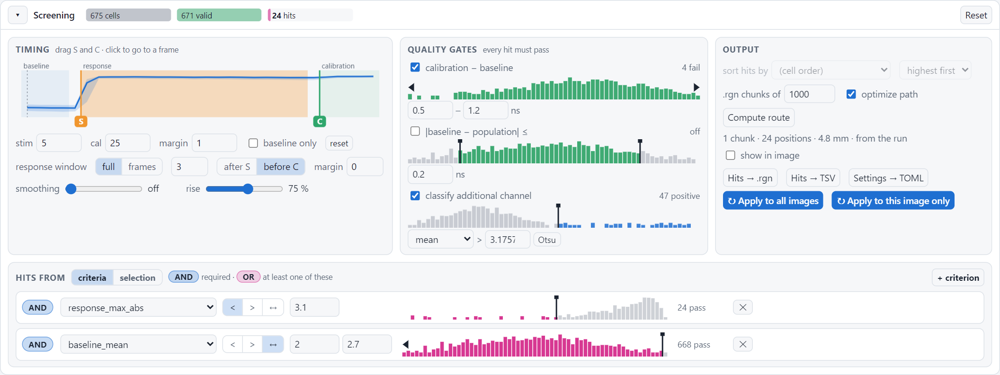
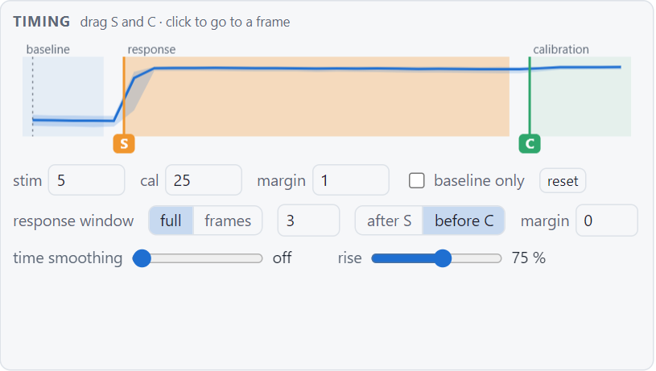
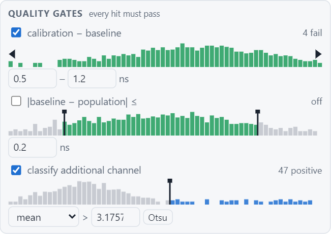
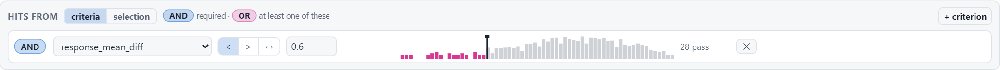
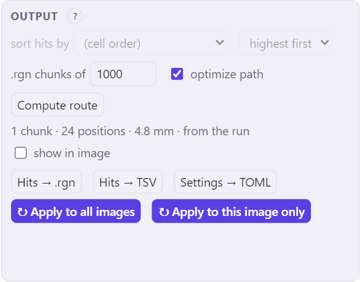

# Choosing the hits

You rarely know the right threshold before you have seen the data. That is why the whole screening can be changed in
the dashboard, after the analysis: you drag a threshold and see at once which cells become hits, in the image, the
traces and the table. When the hits look right, you apply the settings to all images, which also makes new `.rgn`
files.

<figure markdown>
{ .shot }
<figcaption>The Screening pane of a dashboard. The bars at the top count the cells, the valid cells and the
hits.</figcaption>
</figure>

A cell is a hit when it

1. passes the **quality gates** (it is *valid*), and
2. meets the **hit criteria**.

Before that, the **timing** decides which frames are the baseline, the response and the calibration, and so the
values of every cell.

## Timing

<figure markdown>
{ .shot width="480" }
</figure>

The plot shows the average trace of all cells, with the baseline (blue), the response (orange) and the calibration
(green).

- **Stimulation and calibration.** Drag the *S* and *C* markers, or type the frames. Frames count from 0 and mark the
  *first* frame with the stimulus. *reset* goes back to the frames found by the analysis. *baseline only* is for
  movies without stimulation.
- **margin**: frames left out before each transition, so that a stimulus halfway through a frame doesn't count as
  baseline.
- **response window**: the frames whose average is the *mean response* (`response_mean_diff` and
  `response_mean_abs`). *full* uses the whole response; *frames* uses a number of frames, counted *after S* (the
  early response) or *before C* (the late response), with an optional margin.
- **smoothing** smooths the traces over time, for noisy data. **rise** is the fraction of the maximal response that
  defines the rise time (`rise_time_frames`).

## Quality gates

<figure markdown>
{ .shot width="420" }
</figure>

Gates remove cells whose traces cannot be trusted; every hit must pass them. Each gate shows the histogram of its
value over all cells, with draggable limits, and how many cells fail.

- **calibration − baseline**: how much the cell responds to the calibration. A cell that doesn't respond to the
  maximal stimulus probably has no working sensor, or isn't a healthy cell.
- **|baseline − population|**: how far the baseline of the cell is from that of all cells. Very different baselines
  often mean a segmentation error or a dead cell.

A gate can be switched off with its tick box.

## Additional channel

With an additional channel (for instance a marker of transfection, or of one cell line in a mixed population), the
cells are split in two classes on its intensity. Drag the threshold, or click *Otsu* to let the histogram decide. The
class (*ch+* or *ch−*) is shown per cell, and can be used in criteria and in the scatter plot.

## Hit criteria

<figure markdown>
{ .shot }
</figure>

Each criterion is a cell value, *<*, *>* or *between* (↔), and a threshold. The histogram shows the value over all
cells, with the passing cells in pink, and *28 pass* counts them. Drag the black marker to change the threshold.

- **+ criterion** adds a criterion. Hover over a value in the list for its meaning, or see
  [Cell values](../reference/metrics.md).
- **AND / OR**: click the label of a criterion to switch. **AND** criteria are all required; of the **OR** criteria at
  least one must pass. For example *AND baseline < 2.4*, *OR response < 0.5*, *OR rise time > 5* gives cells with a
  low baseline that either respond weakly or slowly.
- **×** removes a criterion.

!!! example "In the example"
    The [example screen](../start/first-analysis.md#what-the-experiment-is-about) looks for ADRB2 knock-out cells
    among wild-type cells: cells that hardly respond to isoproterenol. So the criterion is `response_mean_diff`
    **<** 0.6: an average rise of the lifetime of less than 0.6 ns, where most cells rise by about 0.85 ns. The
    knock-out cells carry a marker (the additional channel), so here you can check the criterion: in the scatter
    plot of `response_mean_diff` against `additional_intensity`, most hits are marker-positive, and the
    marker-positive cells that are not hits are knock-out cells that still respond.

**Hits from *selection*.** Instead of criteria, you can also pick the hits by hand: select cells (click, lasso,
table), switch *Hits from* to *selection* and click *Use selection*. *Add selection* adds more cells.

## Output

<figure markdown>
{ .shot width="400" }
</figure>

- **sort hits by**: the order of the hits in the lists (e.g. strongest response first); by default the cell order.
- **.rgn chunks of**: the maximum number of positions per `.rgn` file. LAS X handles at most about 1000.
- **optimize path**: order the positions so that the microscope travels a short route. *Compute route* computes it
  for the current hits; *show in image* draws it.
- **Hits → .rgn**, **Hits → TSV**: save the current hits of this image. **Settings → TOML**: save these settings.

## Apply the settings

What you change in a dashboard first only affects that dashboard. To make it count, use one of the two **Apply**
buttons. They are only there when the dashboard was opened from the FAST-HIPPOS window (with *Dashboard* or via the
overview), because FAST-HIPPOS itself does the work.

**↻ Apply to all images** uses these screening settings for all images of the output folder. FAST-HIPPOS redoes the
screening of every image, the combined hit list and the `.rgn` files with their routes, the overview and the
dashboards. The segmentation and the traces are kept, so it takes seconds. A message lists the images first, and
says what happens to images that have [settings of their own](own-settings.md).

**↻ Apply to this image only** keeps the settings of the other images, and gives this image its own stimulation
frames and response window, for instance when its stimulation was missed or started later. See
[Settings for single images](own-settings.md).

After applying, the dashboard reloads with the new results, and the FAST-HIPPOS window shows the new settings, so
that a later *Re-apply screening* or *Run analysis* uses them too.

!!! tip "Changed your mind?"
    *Reset* (top right of the Screening pane) brings back the settings with which the dashboard was made.
