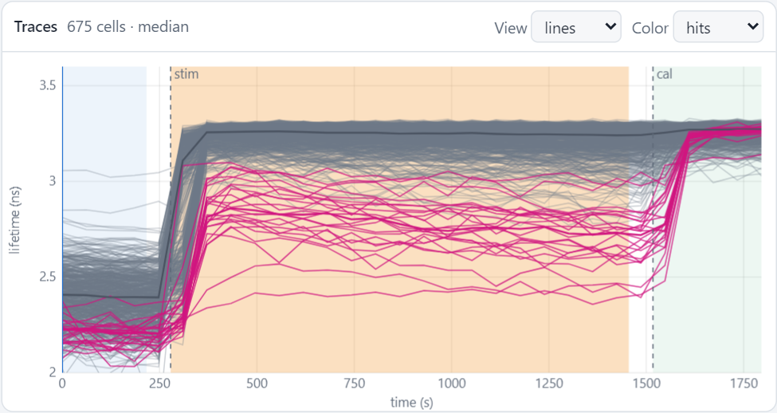
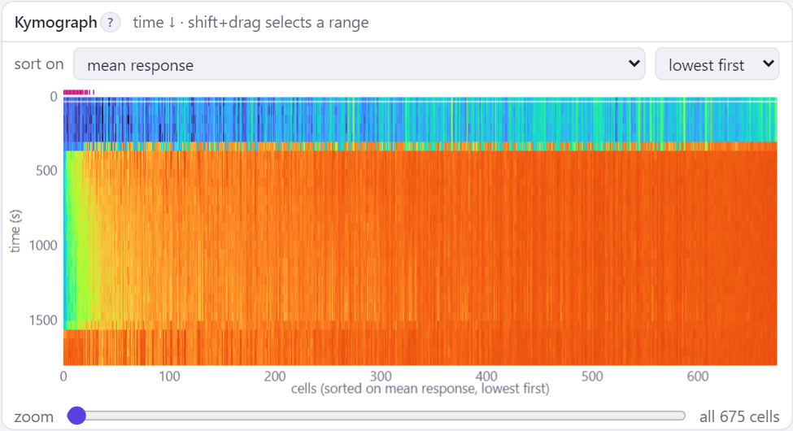
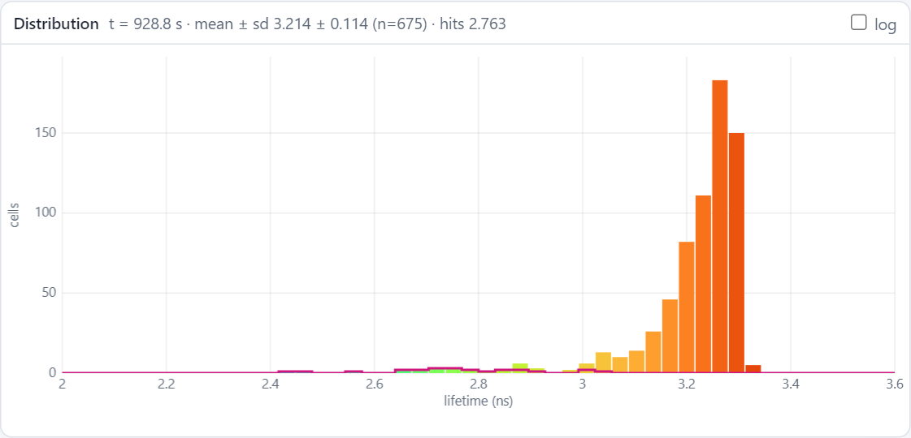
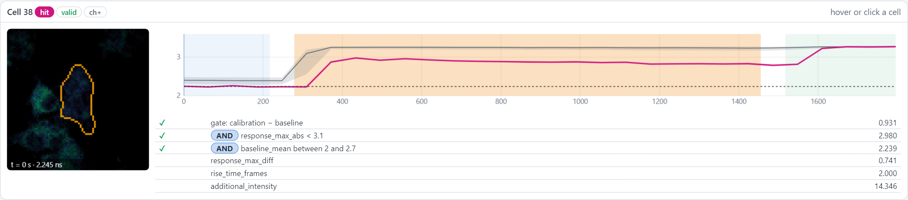
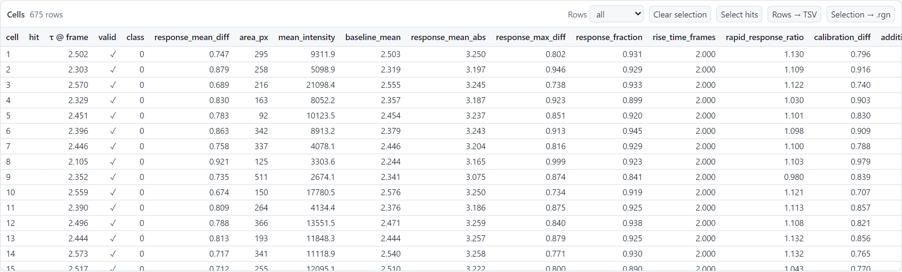

# The dashboard

Every image gets a dashboard: one page with the image, the traces of all cells, their values and the screening, all
linked. It is a single file, `dashboard.html` in the image's folder of the output folder. It needs no internet, no
server and no FAST-HIPPOS: open it in any browser, or send the output folder to a colleague.

[Try it: the dashboard of the example :material-arrow-right:](../start/demo.md){ .md-button }

<figure markdown>
{ .shot }
</figure>

## The top bar

The name of the image, the number of cells and frames, the stimulation and calibration frames (*auto* = detected,
*set* = from the settings, *this image* = [set for this image only](own-settings.md)) and the number of hits. Below
it: play the time-lapse, the frame, the lookup table and the lifetime range of the images, the traces (raw or
smoothed), which cells are shown, and how to select (box or lasso). *↑ Overview* goes to the overview of the run,
◐ switches between light and dark.

## Everything is linked

**Hover** over a cell in the image, a trace, a kymograph column, a point in the scatter plot or a row in the table:
the cell is highlighted (yellow, or orange in the light theme) everywhere, and the *Cell* card shows it in detail.

**Select** cells by clicking; ++ctrl++ + click adds or removes a cell. ++shift++ + drag selects a box or a free-hand
lasso in the image and the scatter plot (++l++ switches between them), or a range of columns in the kymograph. The
selection is outlined in all views. ++esc++ clears it.

## The panels

### Screening

The pane at the top shows how the hits are chosen, and lets you change it: the timing, the quality gates, the
classification on the additional channel, the hit criteria and the output. Every change takes effect at once in all
views. This has its own page: [Choosing the hits](choosing-hits.md). Fold the pane with ▾ to make room.

### Image

<figure markdown>
{ .shot width="600" }
</figure>

The lifetime image of the current frame: colour shows the lifetime, brightness the intensity. *Outlines* (below
the image) shows the outlines of all cells, of the hits, or of the selection only; untick it (or press ++o++) to see
the image without any outlines.

- ++ctrl++ + scroll zooms, dragging pans, double-click zooms in on a cell, ++f++ (or *Fit*) shows the whole image;
  zooming out stops there. *Zoom to selection* (++z++) zooms to the selected cells, or to the hits.
- The percentage above the image is the current zoom; *1:1* (++1++) shows the image at 100 %, one image pixel per
  screen pixel. When zoomed in, a small frame at the top left shows where you are in the image.
- *Lifetime spatial smoothing* (*Ratio* or *Intensity* for those image types) averages the colours over 3 × 3
  pixels (or 5 × 5, 7 × 7, or off), which makes them less noisy; the brightness stays sharp. Over time the image is
  smoothed as the traces are (*time smoothing* under *Timing*, while the traces show the smoothed values); the image
  then says so at the bottom right. Neither changes the values of the cells. The window sets how both start
  (*Display and output → Advanced settings → Smoothing*).
- *Cells* colours the cells by a value instead, for instance their response, so that you see where the responders
  are. *Intensity* plays the intensity as a movie, or shows its projection.
- *route* shows the visiting order of the hits in the `.rgn` files.
- ⤢ shows the image full-screen.

Large images (longer than 1024 pixels) are shown as an overview; zooming in loads the full resolution for the visible
part.

### Traces

<figure markdown>
{ .shot width="600" }
</figure>

The lifetime over time. With few cells you see every trace; with many cells, the median of each group (hits in pink,
other cells in grey, the selection) with bands that hold 50 % and 80 % of the cells, or a density map (*View*). The
coloured backgrounds mark the baseline (blue), the response (orange) and the calibration (green).

### Kymograph

<figure markdown>
{ .shot width="600" }
</figure>

All cells side by side, time running down, colour = lifetime. *sort on* orders the cells, for instance on their mean
response, lowest first: the weak responders are then on the left. The pink ticks at the top mark the hits.

### Distribution and Scatter

{ .shot }

{ .shot }

The **distribution** of the lifetimes in the current frame, with the hits and the selection outlined. *log*
makes the count axis logarithmic, so that a few cells in a tail stay visible next to a high peak, for instance the
low responders of a screen. The **scatter plot** shows
any two values against each other, optionally on log axes, with the cells that are positive for the additional
channel outlined. A lasso in the scatter plot (++shift++ + drag) selects a population, for instance all cells with
a low baseline and a high response.

### Cell

<figure markdown>
{ .shot }
</figure>

The cell under the mouse, or the last cell clicked: a crop that plays along with the time-lapse, its trace (in
colour) against the average of all cells (grey), its baseline (dotted), and for every quality gate and criterion its
value and whether it passes (✓). This is the place to see *why* a cell is, or is not, a hit.

### Cells

<figure markdown>
{ .shot }
</figure>

All cells with all their values. Click a column header to sort. *Rows* shows all cells, the hits, the selection or
the valid cells. *Select hits* selects the hits.

## Exports

| Button | Gives |
|---|---|
| *Rows → TSV* | the table as shown (a tab-separated text file; opens in Excel) |
| *Selection → .rgn* | the stage positions of the selected cells, for LAS X |
| *Hits → .rgn*, *Hits → TSV* (Screening pane) | the current hits |
| *Settings → TOML* (Screening pane) | the screening settings, as a settings file |

## The dashboard remembers

Each dashboard remembers its display settings: colours, ranges, plot choices, scatter axes. After a reload, for
instance when new results arrive after *Apply*, it also keeps the frame, zoom and selection.

## Keys

| Key | |
|---|---|
| ++space++ | play / pause the time-lapse |
| ++arrow-left++ ++arrow-right++ | previous / next frame |
| ++f++ | fit the image |
| ++z++ | zoom to the selection (or the hits) |
| ++1++ | show the image at 100 % |
| ++o++ | show or hide the cell outlines |
| ++l++ | switch between box and lasso selection |
| ++esc++ | clear the selection |
