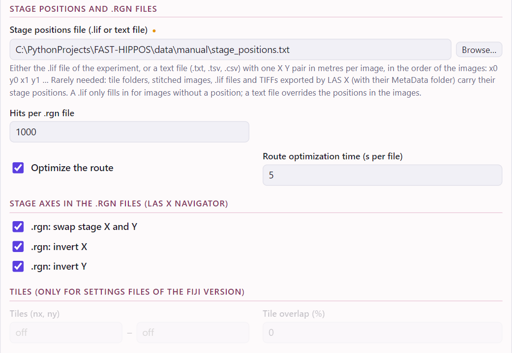

# Back to the microscope

The point of a screen is to do something with the hits: photoactivate them, image them at high resolution, follow
them over time. FAST-HIPPOS writes the stage positions of the hits as LAS X region files (`.rgn`), so that the
microscope can visit them one by one.

## The .rgn files

After a run with screening, the folder of the image holds:

| File | |
|---|---|
| `HITS_<name>.rgn` | all hits of the image |
| `HITS_<name>_1-1000.rgn`, `HITS_<name>_1001-2000.rgn`, … | the hits in files of at most 1000 positions (*Hits per .rgn file*), each with its own short route |
| `hits_1-1000.tsv`, … | the same hits as tables, in visiting order |

`<name>` is the name of the image (its folder). Each file lists
the positions in an order that keeps the stage travel short: the route is optimized, typically 13–18 % shorter than
going from each hit to the nearest next one. The
overview and the dashboards can draw these routes.

To visit the hits:

1. In LAS X, open the **Navigator**.
2. Right-click in it and choose **Load regions**, then choose the `.rgn` file. The positions appear as regions, in
   the visiting order of the file.
3. Set up the experiment that should run at every position (photoactivation, high-resolution imaging, …) and start
   it.

Every image has its own `.rgn` files, in its own folder in the experiment folder (see
[A screen of many images](screen.md)): run the image, visit its hits, then go on with the next image.

With more than one `.rgn` file, load and run them one after another; each next route starts near where the
previous one ended. The `.rgn` files are the same as those of the Fiji version of FAST-HIPPOS.

Need other hits than the analysis gave? The dashboard (*Hits → .rgn*, *Selection → .rgn*) and the overview (*Export*)
save `.rgn` files of the current hits, or of a hand-picked selection.

## Where the stage positions come from

To compute the stage position of a cell, FAST-HIPPOS needs the stage position of its image, and the pixel size.
Usually these are read from the images:

- **Leica `.lif` files**: every image has its position in the file. A tile scan in a `.lif` is stitched, with the
  position of every tile.
- **TIFFs exported from LAS X**: from the `MetaData` folder that LAS X writes next to them. Keep it with the images.
  An image stitched by LAS X has one stage position, that of its centre (see [Tile scans](#tile-scans)).
- **Images stitched by FAST-HIPPOS, or by *Stitch tiles* in Fiji**: from their metadata.

The *Images* card shows for every image whether it has stage positions. For other images, choose a **Stage positions
file** under *Screening → Advanced settings*: a text file with the X and Y stage position (in metres) of every image,
in the order of the images, separated by spaces, tabs, commas or new lines (it replaces the positions in the
images); or the `.lif` file with the positions (used only for images without positions of their own).

Images without stage positions are still analyzed and screened, but their hits get no `.rgn` file; the window warns
about this before the run. A stage positions file is only read by *Run analysis*, not by *Re-apply this image*.

### Stage coordinates and the .rgn frame

The positions file holds the stage X and Y as LAS X stores them in the image metadata (the same as Bio-Formats
shows). The positions in the `.rgn` files and in the tables (`abs_x_m`, `abs_y_m`, in metres) are in the frame of the
LAS X Navigator, measured to the cell. By default, the .rgn X is the negative stage Y, and the .rgn Y the negative
stage X, as on the Leica Stellaris where this was validated. So don't be surprised that they look swapped and
negative.

Microscopes, even of the same type, can differ in this. **Check it once on your microscope**: load a `.rgn` file in
the Navigator and see whether the positions land on the cells. If they don't, change the settings under *Screening →
Advanced settings → Stage axes in the .rgn files*:

<figure markdown>
{ .shot width="560" }
<figcaption>Screening, advanced settings: the stage positions file, the .rgn files and their route, and the stage
axes. The tile settings at the bottom are greyed out: they are only kept for settings files of the Fiji
version.</figcaption>
</figure>

| Setting | Change it when the positions in the Navigator are |
|---|---|
| *.rgn: swap stage X and Y* | rotated by 90°, or mirrored along the diagonal |
| *.rgn: invert X* | mirrored left–right |
| *.rgn: invert Y* | mirrored top–bottom |

*Re-apply this image* uses changed settings: the `.rgn` files are written again, without a new segmentation.

!!! tip "Hit positions on the nucleus"
    By default a hit position is the centre of the cell. With a *Nuclei classifier* (*Cell segmentation → Advanced*),
    trained on a few scribbles with `fast-hippos-cli train-classifier`, it becomes the centre of the nucleus, which is
    more precise for bean-shaped or irregular cells.

## Tile scans

A large area is usually imaged as a tile scan. There are two ways to analyze it.

**Stitched by LAS X.** Export the stitched image (with its `MetaData` folder) and add it with *Add images…*, like
any other image. It has one stage position, that of its centre, and FAST-HIPPOS computes the position of every cell
from its distance to that centre. This is exact as long as the stitching only puts the tiles side by side at their
nominal places: it must not shift or warp tiles, for instance to align overlapping tiles on their content. Check
this once with a `.rgn` file in the Navigator, preferably with hits near the edges of the scan.

**Tiles exported, stitched by FAST-HIPPOS.** When the stitching does shift tiles, or to be independent of how LAS X
stitches:

1. In LAS X, **export the tiles**: one TIFF per tile (`name_s0.tif`, `name_s1.tif`, …), with the `MetaData` folder.
2. In the *Images* card, click **Add tile folder…** and choose the folder. The stitched image is one image.

FAST-HIPPOS reads the position of every tile, corrects the bidirectional scanning phase if *Correct bidirectional
scanning phase* is on (once for all tiles), places each tile at its stage position, and saves the stitched image in
the folder of the image (`<name>_STITCHED.tif`), with the tile positions, so that it can be used again later. Tiles that
overlap are not blended yet: the later tile covers the earlier one.

FAST-HIPPOS saves the tile positions it reads next to the tiles, as `tile_positions.tsv`, and uses that file from then
on; delete it to read the positions again. If the `MetaData` folder is missing, choose the `.lif` file of the scan as
*Stage positions file*: after the first run, the `.lif` file is not needed again.
