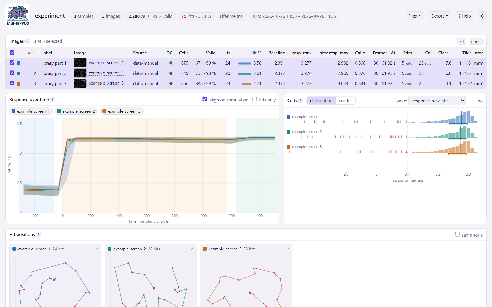
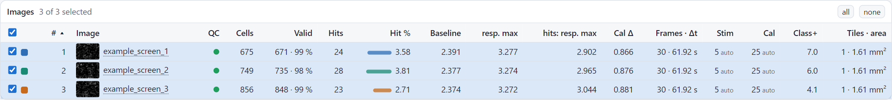
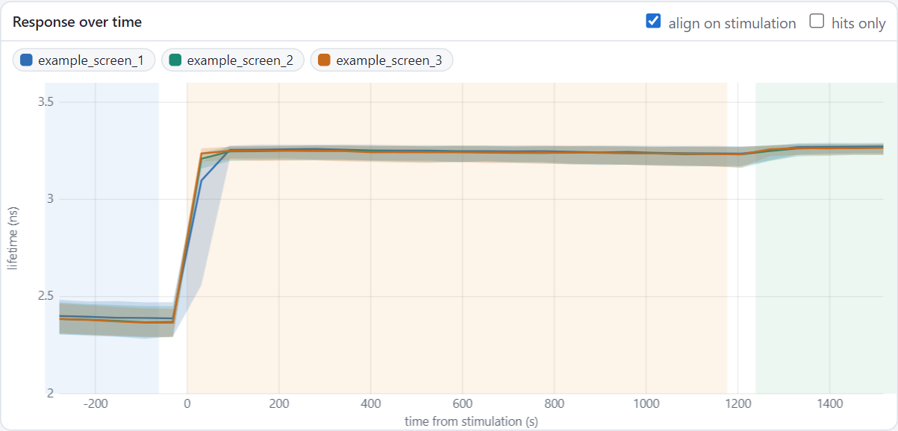
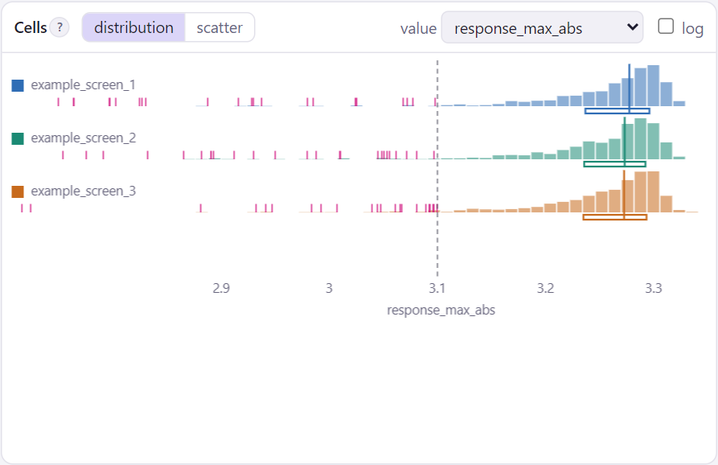
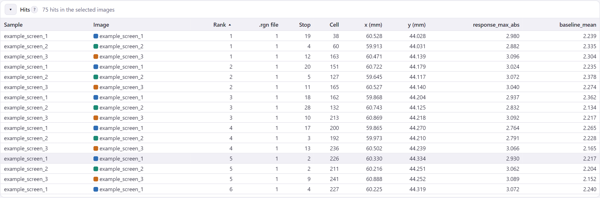

# The overviews

There are two overviews, which work in the same way: the overview of one **sample**, and the overview of the whole
**experiment**, which compares all samples ([A screen of several samples](screen.md)). This page describes the panels
that both have. Did the cells respond? Are there images with few cells, or without calibration? Where are the hits?
The overview of a sample is `index.html` in the folder of the sample; in the FAST-HIPPOS window it is **Sample** in
the bar at the top. The overview of the experiment is `index.html` in the experiment folder, and **Experiment** in
the bar. Like the dashboards they are single files that work in any browser.

The window makes every image a sample, so the overview of a sample usually shows one image (a `.lif` series or a
stitched tile scan is one image too). The comparison of images is made in the experiment overview. A sample with
several images, for instance from `fast-hippos-cli run` with a settings file, has the same page with all its images.

[Try it: the overview of the example :material-arrow-right:](../start/demo.md){ .md-button }

<figure markdown>
{ .shot }
</figure>

The top bar shows the totals: samples (in the experiment overview), images, cells, valid cells, hits, and when the
analysis was made and last re-applied. *Run files* opens the files of the sample (hit lists, `.rgn` files, log);
*Export* downloads tables and `.rgn` files for the selected images. *? Help* opens the manual next to the page; the **?** behind a panel title opens
the part about that panel.

## Images

<figure markdown>
{ .shot }
</figure>

One row per image: a thumbnail, the number of cells and valid cells, the hits, the median baseline, the median
response of all valid cells and of the hits, the calibration response, the frames and frame interval, the
stimulation and calibration frames (*auto* = detected, *set* = from the settings, *image* =
[set for this image only](own-settings.md)), the fraction of cells positive for the additional channel, and the tiles
and area of the scan. Hover over a column header for its exact meaning; click it to sort.

The name of an image opens its dashboard.

**QC.** The dot in the *QC* column is green when nothing stands out, orange or red when something does. Hover over
it for the reason:

| Flag | Means |
|---|---|
| few cells | fewer than 20 cells, or fewer than a quarter of the median of the images |
| low valid fraction | less than 70 % of the cells pass the quality gates (below 40 %: red) |
| no stimulation / calibration | none found, while most images have one |
| stimulation offset | the stimulation is more than 3 frames from the usual frame |
| no calibration response | the cells hardly respond to the calibration |
| no stage positions | the hits of this image cannot be visited |
| no hits | |

These are warnings only: nothing is left out because of them.

**Selecting.** The panels below show the *selected* images, each in its own colour. Click a row to select only that
image, ++ctrl++ + click to add or remove one, ++shift++ + click for a range; *all* and *none* at the top right.

## Response over time

<figure markdown>
{ .shot width="640" }
</figure>

The median trace of the valid cells of each selected image, with a band holding the middle half of the cells.
*align on stimulation* puts time 0 at the stimulation of every image, so that images with the stimulation at different
frames line up. *hits only* shows the hits instead of all cells. Click a name above the plot to hide or show its
curve.

## Cells

<figure markdown>
{ .shot width="520" }
</figure>

One cell value compared between the images. *distribution* shows a histogram per image on a common axis, with the
median and middle half (box), the hits as pink ticks and the threshold of the hit criterion as a dashed line.
*scatter* plots two values against each other, with the hits ringed. *log* makes an axis logarithmic.

## Hit positions

<figure markdown>
{ .shot }
</figure>

A map per image with its hits at their stage positions (in mm), the tiles of the scan, and the route that the
microscope will follow through the `.rgn` files (dashed where the route visits a neighbouring image in between;
images without stage positions get no map). Hover over a hit for its details; click it to open the cell in the
dashboard of its image. *same scale* draws all maps at the same scale, to compare the scanned areas.

## Hits

<figure markdown>
{ .shot }
</figure>

The hits of the selected images (unfold the panel with ▸): their rank in the sample, their `.rgn` file and stop number
in it, their position and the value of the hit criterion. Click a row to open the cell in its dashboard.

## Export

| Export | Gives |
|---|---|
| *Hits → .rgn per image* | one `.rgn` file per selected image, in the visiting order of its sample |
| *Hits → .rgn, selected images together* | one route through the hits of all selected images (only for images of one sample; not in the experiment overview) |
| *Hits → TSV* | the hits of the selected images as a table |
| *Images table → TSV* | the images table as shown, with the QC flags |
| *Cells → TSV* | the values of the cells of the selected images |

Without screening, the overview leaves out everything about hits, and is a comparison of the responses of the images.
