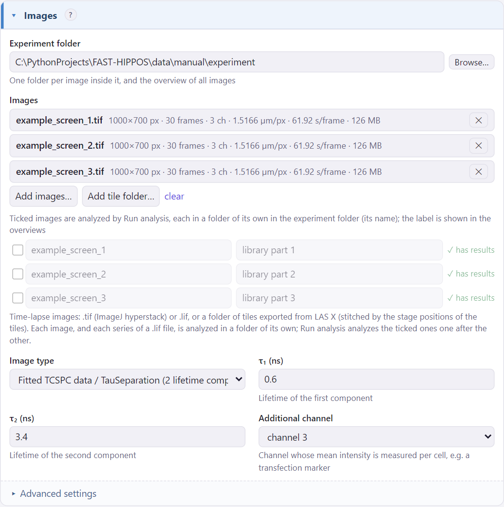
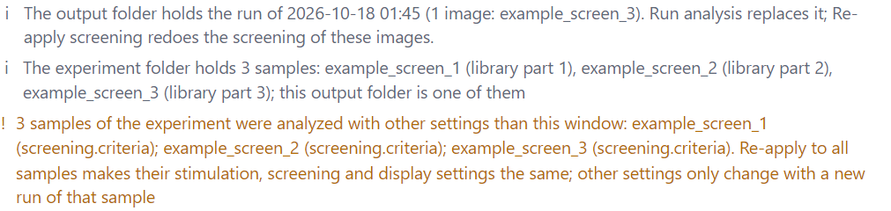
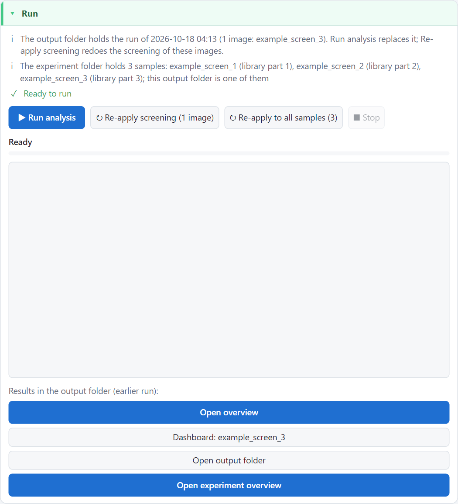

# A screen of several samples

A run analyzes its images together: they are screened with one set of hit criteria, and the overview compares them.
That fits a scan of several areas of one sample. A screen often goes differently: **one (stitched) image per
sample**, every sample analyzed in its own run as soon as it has been imaged, its hits photoactivated on the
microscope, and then the next sample. Afterwards, or while the screen goes on, you want to compare all samples.

For that, FAST-HIPPOS has the **experiment folder**: one folder for the whole screen, with one output folder (one run)
per sample inside it. The experiment folder gets an overview of all samples, which is updated after every run.

## Setting it up

1. In the *Images* card, choose an **Experiment folder** (e.g. `D:\screens\ADRB2 screen`). It may be empty.
2. Add the images of the first sample. The output folder becomes `<experiment folder>\<image name>` (with a number
   added when a sample of that name exists already); you can change it. Give the sample a **Sample label** if you
   like: its condition, plate or library part. The label shows in the experiment overview.
3. **▶ Run analysis**. When the run is done, the `.rgn` files of this sample are in its output folder; see
   [Back to the microscope](microscope.md).
4. For the next sample, click **＋ New sample** (top right of the window). This keeps all settings, but empties the
   image list, the output folder, the sample label, the [settings of single images](own-settings.md) and a file of
   hand-picked hits. Add the images of the next sample, and the output folder is set for you again. Run.

<figure markdown>
{ .shot width="560" }
</figure>

Every run (and every re-apply) of a sample updates the overview of the experiment: `index.html` in the experiment
folder. *Open experiment overview* in the Run card opens it.

```text
ADRB2 screen\                  ← the experiment folder
    index.html                 ← the overview of all samples
    experiment_summary.tsv     ← its images table
    plate 1\                   ← the output folder (run) of one sample
        index.html, HITS_plate 1.rgn, ...
        plate 1\dashboard.html
    plate 2\
        ...
```

A sample is a folder directly inside the experiment folder that holds a complete run. Other folders, and folders whose
name starts with `_`, are left out. To leave out a sample, move its folder out of the experiment folder; the overview
changes at the next run, or at once with `fast-hippos-cli experiment <folder>` (see
[the command line](../reference/command-line.md)).

!!! warning "Give every sample its own output folder"
    The output folder must be a folder *inside* the experiment folder. The window refuses to run into the experiment
    folder itself, and warns when the output folder is somewhere else: such a run is not part of the experiment.

## The experiment overview

<figure markdown>
{ .shot }
</figure>

It works like [the run overview](overview.md), with the images of all samples together:

- the top bar counts the samples, images, cells and hits, and shows when the first and the last sample were analyzed
  (or last re-applied);
- the images table has a **Sample** column (click it for the overview of that run) and a **Label** column; the
  hits table and the exported tables have them too;
- the quality flags compare every image with all images of the experiment (e.g. *few cells* means fewer than in the
  other samples);
- *Samples* (top right) opens the overview of every sample, and the summary table of the experiment;
- *Export* saves `.rgn` files and tables per image, as in a run overview. It has no route through the hits of several
  images together: the samples are different specimens.

Clicking an image opens its dashboard, as in the overview of its run. Opening a sample's output folder in the
window (as output folder) takes over its sample label; the Run card warns when the label in the window differs. Changing the screening in a dashboard and
applying it re-applies the run of that sample, and so updates the experiment overview too.

## Are the samples comparable?

The results of two samples can only be compared when both were analyzed with the same settings. FAST-HIPPOS checks
this in two places:

- **The experiment overview** shows a warning at the top when the samples were not all analyzed with the same
  settings, and lists which settings differ in which samples.
- **The window** warns in the Run card when samples of the experiment were analyzed with other settings than those
  in the window:

<figure markdown>
{ .shot width="560" }
</figure>

Not compared are the settings that do not change the results: the images and folders, the sample label, the
display settings (except *Smooth traces*), the `.rgn` settings (file size, route, axes), the Cellpose environments,
hand-picked hits, and the [settings of single images](own-settings.md), which are deliberate differences. When the
hit criteria differ, the *Cells* panel draws no threshold lines.

**↻ Re-apply to all samples** (in the Run card) makes them the same: it re-applies the stimulation, screening and
display settings of the window to every sample, one after the other, and then updates the experiment overview once.
Each sample keeps its own segmentation and traces, its sample label, its hand-picked hits and the settings of its
single images. It takes seconds per sample. Settings that only a new run changes (segmentation, traces, image type, …) can only be
made the same by running the sample again.

<figure markdown>
{ .shot width="560" }
</figure>

!!! tip "Changing the hit criteria during a screen"
    Re-applying all samples also rewrites their `.rgn` files. Samples that were already photoactivated keep their
    cells, of course: the new hit lists then no longer match what happened on the microscope. Keep the hit criteria of
    a screen fixed once the first sample has been photoactivated, or note which samples were done with which criteria.

## The example

The [example data](../start/first-analysis.md) can be set up as an experiment: each of the three images as a sample
of its own (*library part 1–3*), with the settings of the example. The screenshots on this page show it.
