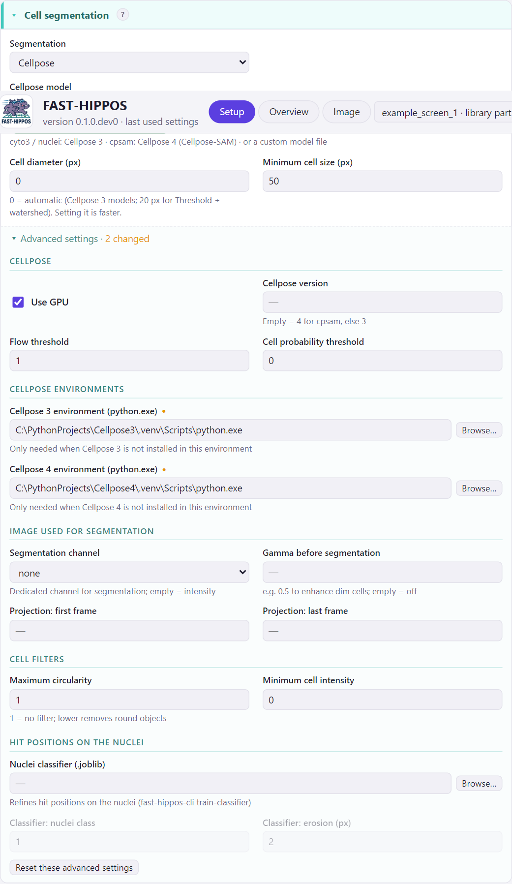

# The FAST-HIPPOS window

FAST-HIPPOS opens in your web browser, but it runs on your own computer: nothing leaves it. Start it with the desktop
shortcut. If it is already running, the shortcut opens the running window again, in a new tab in front; the old tab
closes itself, so that there is always one.

<figure markdown>
{ .shot }
</figure>

The settings are on the left, in cards that follow the steps of the analysis: **Images**, **Cell segmentation**,
**Stimulation and calibration**, **Screening** and **Display and output**. The **Run** card on the right checks the
settings, starts the analysis, shows its progress and opens the results.

## Finding your way

**Hover over anything.** Every setting has a hover text that explains what it does and when to change it. The same
texts are collected in [All settings](../reference/settings.md).

**The manual in the window.** *? Help* opens this manual in a panel on the right. The **?** behind the title of a
card opens the part about that card; ++question++ or ++f1++ opens the part about the card under the mouse. The
dashboards and the overviews have the same help.

**Basic and advanced settings.** Each card shows the settings that a typical run needs. All others are under
*Advanced settings* at the bottom of the card, grouped under subheadings. When advanced settings differ from the
defaults, the card says so (*Advanced settings · 1 changed*) and they are marked, and the line at the top of the
window counts all changed settings that are hidden. *Show all advanced settings* opens them all at once.

<figure markdown>
{ .shot width="560" }
<figcaption>The advanced settings of Cell segmentation, opened.</figcaption>
</figure>

**Greyed-out settings** have no effect with the current choices; the hover text says why. For instance the
stimulation frames when *Baseline only* is ticked, or the screening settings when screening is off.

**Folding.** Click the title of a card to fold it; *Fold all* folds all cards. FAST-HIPPOS remembers which cards are
folded, and also the light or dark look (◐).

## The cards

### Images

The images to analyze and where the results go. All images of a run are analyzed with the same settings, and screened
together.

- **Add images…**: time-lapse `.tif` files (ImageJ hyperstacks) or Leica `.lif` files. A `.lif` file can hold many
  images; they are all analyzed, unless you choose some under *Advanced → .lif series*.
- **Add tile folder…**: a folder of tiles exported from LAS X, which FAST-HIPPOS stitches by their stage positions;
  see [Back to the microscope](microscope.md#tile-scans).
- Every image shows what was read from it: size, frames, channels, pixel size, frame interval, and whether it holds
  stage positions.
- **Experiment folder** (optional): for a screen with one run per sample, the folder that holds the output folders
  of all samples, and their joint overview. Empty for a single run. See [A screen of several samples](screen.md).
- **Output folder**: one folder per run. See [the output folder](output-folder.md). With an experiment folder, a
  folder inside it, named after the first image.
- **Sample label** (with an experiment folder): a short description of the sample, shown in the experiment overview.
- **Image type**: what the pixel values mean, and so how the value per cell is computed: two-component TCSPC fits
  (with τ₁ and τ₂), Fast FLIM, TauContrast, frequency-domain FLIM, ratio imaging, or intensity only.
- **Additional channel**: optionally a channel whose intensity is measured per cell, e.g. a transfection marker.
  The cells can then be split into positive and negative cells.

### Cell segmentation

How the cells are found, in a projection of the time-lapse:

- **Cellpose** with a model: `cyto3` or `nuclei` (Cellpose 3), `cpsam` (Cellpose 4, Cellpose-SAM), or a model of your
  own. A label shows the Cellpose version and whether the GPU is used, or what is wrong.
- **Existing label image**: a segmentation made elsewhere, e.g. in Fiji, with one number per cell.
- **Threshold + watershed**: a classical segmentation, without Cellpose. It uses an automatic (Otsu) threshold on
  the projection and the *Cell diameter* to split touching cells (0 = 20 px). Dim cells next to bright ones can be
  missed: then set *Gamma before segmentation* (advanced) to e.g. 0.5.

*Cell diameter* 0 lets Cellpose estimate it. Small objects can be removed with *Minimum cell size*; the advanced
settings also filter on circularity and intensity, and choose which frames are projected.

### Stimulation and calibration

When the stimulus and the calibration happened. Leave the frames empty and FAST-HIPPOS detects them in the average
trace of all cells; or fill in the first frame with the stimulus (counting from 0). When you set only one of them,
the other is still detected (the calibration after the stimulation, or the stimulation before the calibration).

- **No calibration**: for experiments without a calibration, e.g. a transient response. Only the stimulation is
  looked for (or set), and the response lasts until the end of the movie. Without it, the decay of a transient can
  be taken for a calibration.
- **Baseline only**: for movies without stimulation. When no stimulation is found in a movie, it is analysed as
  baseline only as well (the log says so, and the overview flags it).

Below the frames, the card lists the images that have [settings of their own](own-settings.md), for instance another
stimulation frame.

### Screening

Tick **Screen for hits** and add the hit criteria: a cell value, *<* or *>*, and a threshold. Several criteria can be
required together (AND), or be alternatives of which one is enough (OR). The thresholds are easiest to set in the
dashboard, after the analysis; see [Choosing the hits](choosing-hits.md). *Classify cells on the additional channel*
splits the cells on the marker intensity.

The advanced settings hold the response window, the quality gates, the sorting of the hit list, and everything about
stage positions and `.rgn` files.

### Display and output

The colour scale of the lifetime images, the size of the dashboards, and which files are saved. The defaults suit
most runs, and colours and ranges can also be changed in the dashboard.

## The Run card

<figure markdown>
{ .shot width="560" }
</figure>

**Checks.** The top of the card checks the settings against the images, all the time. Red problems would stop the
analysis and disable *Run analysis*: no images, frames beyond the end of the movie, a calibration before the
stimulation, Cellpose not found. Orange warnings point out surprises: images without stage positions get no `.rgn`
files, the output folder already holds results, Cellpose will run without GPU.

**▶ Run analysis** analyzes all images: segmentation, traces, stimulation detection, screening, dashboards. If the
output folder already holds a run, FAST-HIPPOS first tells you exactly which results will be replaced.

**↻ Re-apply screening** redoes only the part after the segmentation and the traces (stimulation detection,
screening, hit lists, `.rgn` files, dashboards) for the images of the run in the output folder, with the current
settings. It takes seconds instead of minutes. Use it after changing screening settings.

**■ Stop** stops a running analysis; the results of the previous run are then kept.

With an [experiment folder](screen.md), the card also lists the samples of the experiment and warns when some were
analyzed with other settings than those in the window. **↻ Re-apply to all samples** then re-applies the settings of
the window to every sample, and **＋ New sample** (top right of the window) starts the next sample with the same
settings.

The **log** shows the progress. When the run is done, the buttons below it open the overview, the dashboard of each
image, and the output folder, and with an experiment folder also the experiment overview.

## Settings files

FAST-HIPPOS remembers the settings of the window (after every change, and the settings applied from a
dashboard), and starts with them next time. Every run also saves its settings in the
output folder (`fast_hippos_settings.toml`). **Open settings…** loads such a file, **Save settings…** saves the current
settings, and **Defaults** goes back to the default settings (the images and the output folder stay). Both keep
the Cellpose environments you set, since they belong to the computer rather than to an experiment (unless the loaded
file names its own). Settings files
can also be used on the [command line](../reference/command-line.md).

## Quitting

**Quit** stops FAST-HIPPOS, and a running analysis, after asking. When you just close the browser tab, FAST-HIPPOS
stops by itself after 15 minutes.
