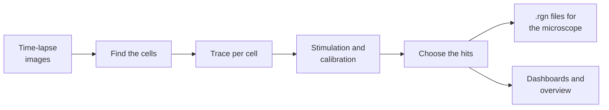

# FAST-HIPPOS

**F**LIM **A**nalysis of **S**ingle-cell **T**races for **H**it **I**dentification of **P**henotypes in **P**ooled
**O**ptical **S**creening

FAST-HIPPOS finds the cells that respond differently in a time-lapse experiment, and sends the microscope back to
exactly those cells. You image a field with thousands of cells while you stimulate them; FAST-HIPPOS measures a
lifetime trace for every cell, picks the cells whose response matches what you are looking for, and writes their
stage positions as Leica LAS X `.rgn` files. The microscope can then revisit the hits, for photoactivation,
high-resolution imaging, FRAP or anything else.

Outside screening, it is a fast way to get single-cell traces out of a FLIM, ratio or intensity time-lapse, and to
look at them.

!!! warning "Test version"
    The Python version of FAST-HIPPOS is still being tested and has not yet been validated for production
    screening. For experiments, use the [Fiji version](https://imagej.net/plugins/fast-hippos), or compare the
    results with it.

<figure markdown>
{ .shot }
<figcaption>The dashboard of one image: 675 cells, coloured by their lifetime. The 13 hits (outlined in pink) are the
cells that barely respond to the stimulation; their median trace is the pink curve.</figcaption>
</figure>

## How it works

-   :material-microscope:{ .lg } **1. Image**

    Record a time-lapse of many cells: a baseline, then the stimulus, and at the end, if you like, a calibration
    (a maximal stimulus that shows that the sensor works).

-   :material-cog-play:{ .lg } **2. Analyze**

    Choose the images and a few settings in the [FAST-HIPPOS window](guide/window.md) and click *Run analysis*. Cellpose
    finds the cells, FAST-HIPPOS measures their traces and detects the stimulation.

-   :material-chart-bell-curve:{ .lg } **3. Choose the hits**

    Set the hit criteria in the [dashboard](guide/dashboard.md), and see the hits change while you drag the threshold.
    Check them in the image, the traces and the [overview](guide/overview.md) of all images.

-   :material-target:{ .lg } **4. Revisit**

    Load the `.rgn` files in LAS X: the microscope [visits every hit](guide/microscope.md), along a short route.

## The paper

FAST-HIPPOS (in its Fiji version) and the screening method it serves are described in:

> Mukherjee S, van Tooren M, Sfakianakis D, Kemps D, Klarenbeek J, Zanetti G, Kuiken HJ, Lieftink C, van den Broek B,
> Beijersbergen RL, Jalink K. *Beyond Static Screens: optical pooled screening of signaling dynamics using time-lapse
> FLIM.* bioRxiv 2025. [doi:10.1101/2025.07.11.664338](https://doi.org/10.1101/2025.07.11.664338)

## Where to start

- New to FAST-HIPPOS? [Install it](start/install.md) and follow [your first analysis](start/first-analysis.md), with
  example data.
- Curious first? [Try the dashboard and the overview in your browser](start/demo.md), without installing anything.
- Looking for one setting? [All settings](reference/settings.md) has a filter.
