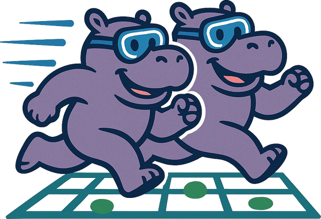
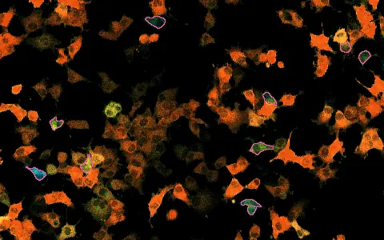
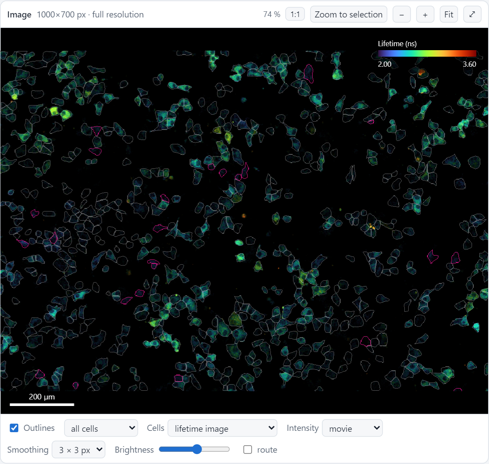
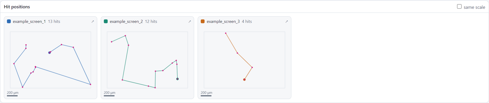
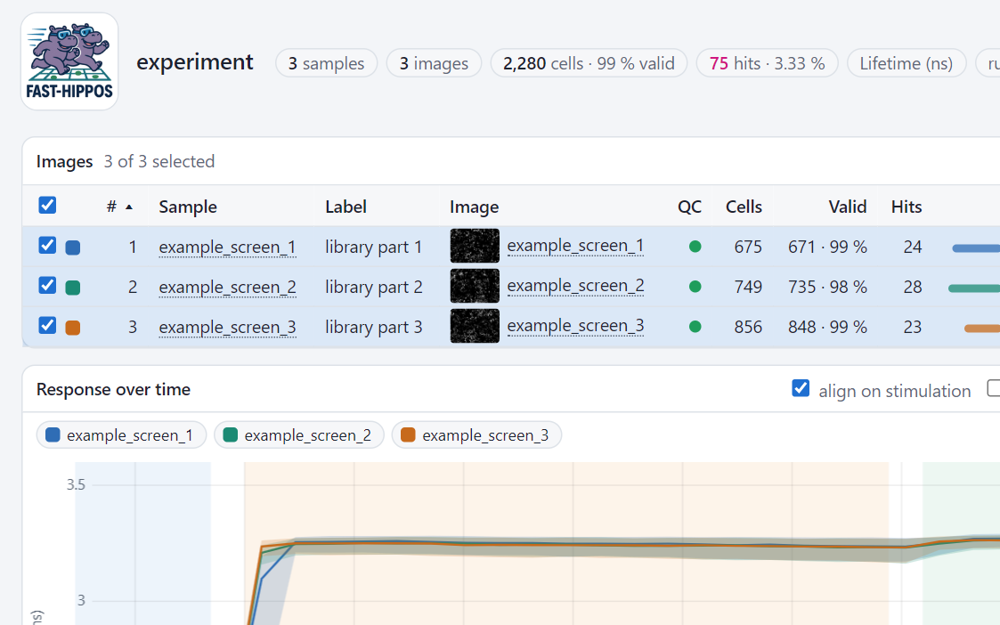

<!-- the hero is plain HTML: inside a Markdown block, nested HTML on one line is cut apart -->

<h1 id="fast-hippos">FAST-HIPPOS</h1>

<b>F</b>LIM <b>A</b>nalysis of <b>S</b>ingle-cell <b>T</b>races for <b>H</b>it <b>I</b>dentification of
<b>P</b>henotypes in <b>P</b>ooled <b>O</b>ptical <b>S</b>creening

Image thousands of cells while you stimulate them. FAST-HIPPOS follows every cell through the time-lapse, picks the
ones whose response stands out, and turns them into stage positions for the microscope: to photoactivate them,
image them at high resolution, or anything else.

<a class="md-button md-button--primary" href="start/install/">Get started</a>
<a class="md-button" href="start/demo/">Try it in your browser</a>

<figure class="fh-hero-movie">

frame 17 · <b>hits found</b>

Lifetime (ns)

2.03.6

<button class="fh-movie-play" type="button" aria-label="Play" title="Play or pause (the movie also stops while the mouse is on it)" hidden>⏵</button>

<figcaption>Real data: cells with a cAMP sensor, coloured by their lifetime. After the stimulus nearly all cells
respond (orange); the few that don't are the hits (pink).</figcaption>
</figure>

## From image to action { .fh-center }

Follow every cell over time, and act on the result while the cells are still on the stage.

<svg viewBox="0 0 720 440" role="img" aria-labelledby="fh-loop-title">
  <title id="fh-loop-title">The screening loop: image, analyze, decide, act, and back to the microscope</title>
  <!-- the ring, with arrows between the steps -->
  <path id="fh-ring" class="fh-ring" d="M360,65 A150,150 0 1,1 359.9,65"/>
  <path class="fh-chevron" d="M466.1,96.2 L472.4,115.3 L453.3,108.9"/>
  <path class="fh-chevron" d="M478.8,321.1 L459.7,327.4 L466.1,308.3"/>
  <path class="fh-chevron" d="M253.9,333.8 L247.6,314.7 L266.7,321.1"/>
  <path class="fh-chevron" d="M241.2,108.9 L260.3,102.6 L253.9,121.7"/>
  <!-- a pulse travelling around the loop -->
  <circle class="fh-pulse" r="6"><animateMotion dur="8s" repeatCount="indefinite"><mpath href="#fh-ring"/></animateMotion></circle>

  <!-- the centre, a scene per step, on the clock of the pulse: the cells (Image), a trace for each (Analyze), the
       hit stands out (Decide), the hit is photoactivated (Act) -->
  <g class="fh-cap">
    <text x="360" y="150" class="fh-small fh-mid">imaging the cells<animate attributeName="opacity" values="1;1;0;0;0" keyTimes="0;0.22;0.25;0.97;1" dur="8s" repeatCount="indefinite"/></text>
    <text x="360" y="150" class="fh-small fh-mid" opacity="0">a trace for every cell<animate attributeName="opacity" values="0;0;1;1;0;0" keyTimes="0;0.25;0.28;0.47;0.5;1" dur="8s" repeatCount="indefinite"/></text>
    <text x="360" y="150" class="fh-small fh-mid" opacity="0">the hit stands out<animate attributeName="opacity" values="0;0;1;1;0;0" keyTimes="0;0.5;0.53;0.72;0.75;1" dur="8s" repeatCount="indefinite"/></text>
    <text x="360" y="150" class="fh-small fh-mid" opacity="0">photoactivating the hit<animate attributeName="opacity" values="0;0;1;1;0" keyTimes="0;0.75;0.78;0.97;1" dur="8s" repeatCount="indefinite"/></text>
  </g>
  <g><animate attributeName="opacity" values="1;1;0;0;1;1" keyTimes="0;0.23;0.27;0.73;0.77;1" dur="8s" repeatCount="indefinite"/>
    <ellipse cx="304" cy="186" rx="15" ry="10" transform="rotate(-15 304 186)" class="fh-cell"/>
    <ellipse cx="339" cy="176" rx="12" ry="9" transform="rotate(10 339 176)" class="fh-cell"/>
    <ellipse cx="373" cy="190" rx="14" ry="10" transform="rotate(0 373 190)" class="fh-cell"/>
    <ellipse cx="410" cy="180" rx="12" ry="9" transform="rotate(20 410 180)" class="fh-cell"/>
    <ellipse cx="318" cy="224" rx="14" ry="10" transform="rotate(10 318 224)" class="fh-cell"/>
    <ellipse cx="354" cy="230" rx="15" ry="11" transform="rotate(-10 354 230)" class="fh-cell"/>
    <ellipse cx="420" cy="246" rx="11" ry="8" transform="rotate(0 420 246)" class="fh-cell"/>
    <ellipse cx="334" cy="255" rx="12" ry="8" transform="rotate(15 334 255)" class="fh-cell"/>
    <ellipse cx="378" cy="256" rx="11" ry="8" transform="rotate(-20 378 256)" class="fh-cell"/>
    <ellipse cx="395" cy="222" rx="13" ry="10" transform="rotate(5 395 222)" class="fh-cell"/>
    <g opacity="0"><animate attributeName="opacity" values="0;0;1;1;0" keyTimes="0;0.77;0.8;0.96;1" dur="8s" repeatCount="indefinite"/>
      <ellipse cx="395" cy="222" rx="13" ry="10" transform="rotate(5 395 222)" class="fh-cell fh-cell-hit"/>
      <circle cx="395" cy="222" r="6" class="fh-beam"><animate attributeName="r" values="6;22" dur="0.9s" repeatCount="indefinite"/><animate attributeName="opacity" values="1;0" dur="0.9s" repeatCount="indefinite"/></circle>
      <path d="M395,202 L395,209 M395,235 L395,242 M373,222 L380,222 M410,222 L417,222" class="fh-cross"/>
    </g>
  </g>
  <g opacity="0"><animate attributeName="opacity" values="0;0;1;1;0;0" keyTimes="0;0.23;0.27;0.73;0.77;1" dur="8s" repeatCount="indefinite"/>
    <line x1="285" y1="258" x2="437" y2="258" class="fh-axis"/>
    <line x1="306" y1="160" x2="306" y2="258" class="fh-event"/>
    <line x1="410" y1="160" x2="410" y2="258" class="fh-event"/>
    <text x="306" y="272" class="fh-tiny fh-mid">stimulus</text>
    <text x="410" y="272" class="fh-tiny fh-mid">calibration</text>
    <g><animate attributeName="opacity" values="1;1;0.22;0.22" keyTimes="0;0.5;0.64;1" dur="8s" repeatCount="indefinite"/>
      <path class="fh-trace fh-resp" d="M285,240 L306,241 C312,241 314,190 324,186 L410,184 C413,184 415,174 420,173 L437,172" stroke-dasharray="260" stroke-dashoffset="260"><animate attributeName="stroke-dashoffset" values="260;260;0;0" keyTimes="0;0.25;0.42;1" dur="8s" repeatCount="indefinite"/></path>
      <path class="fh-trace fh-resp" d="M285,236 L306,236 C312,236 316,196 327,193 L410,190 C413,190 416,178 421,177 L437,176" stroke-dasharray="260" stroke-dashoffset="260"><animate attributeName="stroke-dashoffset" values="260;260;0;0" keyTimes="0;0.25;0.42;1" dur="8s" repeatCount="indefinite"/></path>
      <path class="fh-trace fh-resp" d="M285,244 L306,243 C313,243 316,200 328,197 L410,195 C413,195 416,181 421,180 L437,179" stroke-dasharray="260" stroke-dashoffset="260"><animate attributeName="stroke-dashoffset" values="260;260;0;0" keyTimes="0;0.25;0.42;1" dur="8s" repeatCount="indefinite"/></path>
    </g>
    <path class="fh-trace fh-resp" d="M285,242 L306,242 C315,242 320,236 330,235 L410,234 C413,234 415,182 421,180 L437,179" stroke-dasharray="260" stroke-dashoffset="260"><animate attributeName="stroke-dashoffset" values="260;260;0;0" keyTimes="0;0.25;0.42;1" dur="8s" repeatCount="indefinite"/></path>
    <path class="fh-trace fh-hitline" d="M285,242 L306,242 C315,242 320,236 330,235 L410,234 C413,234 415,182 421,180 L437,179" opacity="0"><animate attributeName="opacity" values="0;0;1;1" keyTimes="0;0.5;0.56;1" dur="8s" repeatCount="indefinite"/></path>
  </g>

  <!-- the steps -->
  <g class="fh-node" transform="translate(360,65)">
    <circle r="34" class="fh-glow"><animate attributeName="opacity" values="0.85;0;0" keyTimes="0;0.25;1" dur="8s" repeatCount="indefinite"/></circle>
    <circle r="27" class="fh-disc"/>
    <circle cx="-9" cy="-6" r="6" class="fh-icon-cell"/><circle cx="8" cy="-7" r="5" class="fh-icon-cell"/>
    <circle cx="-2" cy="9" r="6" class="fh-icon-cell"/><circle cx="12" cy="8" r="4" class="fh-icon-cell fh-icon-hit"/>
  </g>
  <g class="fh-node" transform="translate(510,215)">
    <circle r="34" class="fh-glow"><animate attributeName="opacity" values="0.85;0;0" keyTimes="0;0.25;1" dur="8s" begin="2s" repeatCount="indefinite"/></circle>
    <circle r="27" class="fh-disc"/>
    <path d="M-15,8 L-6,8 C-3,8 -2,-9 3,-9 L15,-9" class="fh-icon-line"/>
    <path d="M-15,11 L15,11" class="fh-icon-thin"/>
  </g>
  <g class="fh-node" transform="translate(360,365)">
    <circle r="34" class="fh-glow"><animate attributeName="opacity" values="0.85;0;0" keyTimes="0;0.25;1" dur="8s" begin="4s" repeatCount="indefinite"/></circle>
    <circle r="27" class="fh-disc"/>
    <path d="M-15,-4 L15,-4" class="fh-icon-dash"/>
    <circle cx="-9" cy="-11" r="3" class="fh-icon-dot"/><circle cx="1" cy="-12" r="3" class="fh-icon-dot"/><circle cx="10" cy="-10" r="3" class="fh-icon-dot"/>
    <circle cx="-4" cy="6" r="3.5" class="fh-icon-dot fh-icon-hit"/><circle cx="7" cy="9" r="3.5" class="fh-icon-dot fh-icon-hit"/>
  </g>
  <g class="fh-node" transform="translate(210,215)">
    <circle r="34" class="fh-glow"><animate attributeName="opacity" values="0.85;0;0" keyTimes="0;0.25;1" dur="8s" begin="6s" repeatCount="indefinite"/></circle>
    <circle r="27" class="fh-disc"/>
    <circle r="11" class="fh-icon-thin"/><circle r="3.5" class="fh-icon-dot fh-icon-hit"/>
    <path d="M0,-17 L0,-8 M0,8 L0,17 M-17,0 L-8,0 M8,0 L17,0" class="fh-icon-thin"/>
  </g>

  <text x="360" y="18" class="fh-label fh-mid">Image</text>
  <text x="360" y="36" class="fh-small fh-mid">a time-lapse of thousands of cells</text>
  <text x="560" y="210" class="fh-label">Analyze</text>
  <text x="560" y="230" class="fh-small">find the cells, trace them,</text>
  <text x="560" y="247" class="fh-small">detect the stimulus</text>
  <text x="360" y="420" class="fh-label fh-mid">Decide</text>
  <text x="360" y="438" class="fh-small fh-mid">hits by their dynamics, live in the dashboard</text>
  <text x="160" y="210" class="fh-label fh-end">Act</text>
  <text x="160" y="230" class="fh-small fh-end">the microscope revisits</text>
  <text x="160" y="247" class="fh-small fh-end">every hit, along a short route</text>
</svg>

-   :material-microscope:{ .lg } **Image**

    Record a time-lapse of many cells: a baseline, then the stimulus, and at the end, if you like, a calibration
    (a maximal stimulus that shows that the sensor works). FLIM, ratio or intensity data; large areas as tile scans.

-   :material-cog-play:{ .lg } **Analyze**

    Choose an experiment folder, the images (each is a sample) and a few settings in the
    [FAST-HIPPOS window](guide/window.md) and click *Run analysis*. Cellpose finds the cells; FAST-HIPPOS measures a
    trace for each of them and detects the stimulation.

-   :material-chart-bell-curve:{ .lg } **Decide**

    Set the hit criteria in the [dashboard](guide/dashboard.md) and see the hits change while you drag the
    threshold. Compare the [samples of a whole screen](guide/screen.md) in the experiment overview.

-   :material-target:{ .lg } **Act**

    Load the `.rgn` files in LAS X: the microscope [visits every hit](guide/microscope.md), along a short route.
    Then on to the next sample.

## Features

-   

    **[The dashboard](guide/dashboard.md)** of every image: the cells coloured by their lifetime, their traces, a
    kymograph, distributions and scatter plots. Set the hit criteria there and watch the hits change.

-   

    **[The overviews](guide/overview.md)** of a sample and of the whole experiment: responses, cells and hits,
    quality flags, and where the hits are on the stage.

-   

    **[The FAST-HIPPOS window](guide/window.md)** checks the settings against the images before anything runs, and
    re-applies new screening settings in seconds.

-   

    **[Samples and experiments](guide/screen.md)**: every image is a sample. Analyze each sample as soon as it has been
    imaged, and compare all samples in one overview.

## Where to start

-   :material-download:{ .lg } **[Install it](start/install.md)** and follow
    [your first analysis](start/first-analysis.md), with example data.

-   :material-web:{ .lg } **[Try it in your browser](start/demo.md)**: the dashboard and the experiment overview of the
    example, without installing anything.

-   :material-tune:{ .lg } **[Look up a setting](reference/settings.md)**: all settings, with a filter.

!!! note "Beta"
    The analysis has been checked against the [Fiji version](https://imagej.net/plugins/fast-hippos) and on test
    data, but one step has not been tried on the microscope yet: the `.rgn` files that this version writes. Before
    you rely on them, load one in the LAS X Navigator and check that the positions land on the cells (see
    [Back to the microscope](guide/microscope.md#stage-coordinates-and-the-rgn-frame)). Settings and file formats
    may still change.

## The paper

FAST-HIPPOS (in its Fiji version) and the screening method it serves are described in:

> Mukherjee S, van Tooren M, Sfakianakis D, Kemps D, Klarenbeek J, Zanetti G, Kuiken HJ, Lieftink C, van den Broek B,
> Beijersbergen RL, Jalink K. *Beyond Static Screens: optical pooled screening of signaling dynamics using time-lapse
> FLIM.* bioRxiv 2025. [doi:10.1101/2025.07.11.664338](https://doi.org/10.1101/2025.07.11.664338)
