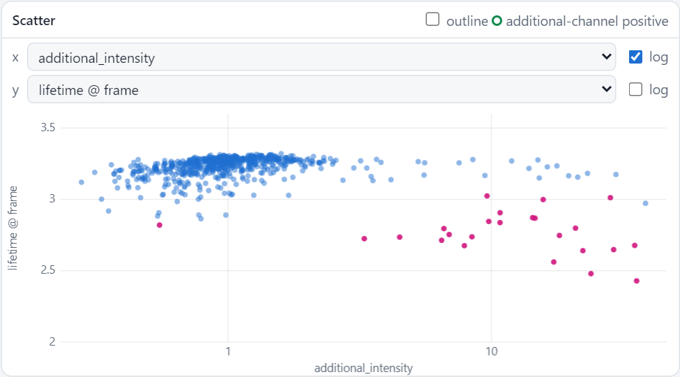

# Your first analysis

This walk-through analyzes the example data from start to finish, in about ten minutes. You will find the cells,
measure their lifetime traces, pick the cells that respond weakly to the stimulation, and get their stage positions
for the microscope.

## The example data

### What the experiment is about

The example comes from a test of a screen for cAMP signaling, of the kind described in our paper
[*Beyond Static Screens: optical pooled screening of signaling dynamics using time-lapse FLIM*](https://www.biorxiv.org/content/10.1101/2025.07.11.664338v3.full)
(Mukherjee et al., bioRxiv 2025, Fig. 4).

- **The cells** are Cos7 cells with the FRET-FLIM sensor EpacH250, which reports cAMP: when cAMP rises, the
  fluorescence lifetime of the sensor rises.
- **The stimulation** is isoproterenol, which activates the β-adrenergic receptors. In normal (wild-type) cells this
  gives a strong, sustained cAMP response. The **calibration** at the end is forskolin, which activates the adenylyl
  cyclases directly and gives the maximal response in every cell with a working sensor.
- **The mix**: about 5 % of the cells are ADRB2 knock-out cells: they lack the β2-adrenergic receptor, so most of
  them respond weakly or not at all to isoproterenol, but they still respond to forskolin. They were mixed with
  95 % wild-type cells to simulate the rare hits of a real pooled screen.
- **The marker**: before mixing, the knock-out cells were labelled with the photoactivatable dye PA-JF646 (the third
  channel). In a real screen you don't know beforehand which cells are hits; here the marker tells you, so you can
  see how well the hit criterion works.

So in this screen the hits are the **low responders**: cells with a small mean response to isoproterenol, while
they do respond to the calibration. (The paper used the same idea: a mean response lifetime below 3.05 ns in the
frames before the calibration.)

### Download

[Download the example data](https://github.com/Jalink-lab/FAST-HIPPOS-Python/releases/tag/example-data) (a ZIP file)
and unpack it, for instance to `C:\Data\FAST-HIPPOS example`. It holds three images of the same screen and two small
text files:

| File | |
|---|---|
| `example_screen_1.tif` … `example_screen_3.tif` | three fields of a pooled screen, 1000 × 700 pixels, 30 frames of 62 s |
| `stage_positions.txt` | the stage position of each image (normally this is stored in the images themselves) |
| `example_settings.toml` | all settings of this walk-through: *Open settings…* in the window loads them at once |

Each image has three channels: the two amplitude images of a two-component lifetime fit (lifetimes 0.6 and 3.4 ns,
as exported from LAS X), and the PA-JF646 marker of the knock-out cells. Isoproterenol was added in frame 5: the
lifetime of most cells then rises by about 0.8 ns. In frame 25 the forskolin calibration follows. We look for the
few cells that **hardly respond** to isoproterenol.

## 1. Open FAST-HIPPOS

Double-click the FAST-HIPPOS shortcut on the desktop. The window opens in your web browser; it consists of cards
for the settings on the left and the *Run* card on the right.

<figure markdown>
{ .shot }
<figcaption>The FAST-HIPPOS window, here after the analysis of the example: the settings on the left, the checks, the
log and the results on the right.</figcaption>
</figure>

## 2. Images

<figure markdown>
{ .shot width="560" }
</figure>

<ol class="callouts" markdown>
<li markdown>Click **Browse…** next to *Experiment folder* and choose (or make) an empty folder, e.g.
`C:\Data\FAST-HIPPOS example\experiment`. All results go there, one folder per image. (If you skip this, adding
the images proposes a folder *FAST-HIPPOS* next to them.) You always need an experiment folder, also for a single
image of your own: it is then an experiment of one image.</li>
<li markdown>Click **Add images…** and choose the three `example_screen_*.tif` files. Each image shows its size, frames,
channels, pixel size and frame interval, read from the file. Below the images, every
image gets a row with a tick box, its name (its folder in the experiment folder) and an optional label, e.g. the
condition. All three are ticked: they are all analyzed.</li>
<li markdown>*Image type*: **Fitted TCSPC data / TauSeparation**, with τ₁ = **0.6** and τ₂ = **3.4** ns: the lifetimes of
the two components of the fit.</li>
<li markdown>*Additional channel*: **channel 3**, the marker. FAST-HIPPOS measures its intensity in every cell.</li>
</ol>

## 3. Cell segmentation

<figure markdown>
{ .shot width="560" }
</figure>

Leave **Cellpose** with the model **cyto3**. The green label shows that FAST-HIPPOS found Cellpose and a GPU. If it
shows a problem instead, see [Installation → Cellpose](install.md#4-cellpose). The cell diameter **0** means that
Cellpose estimates it.

## 4. Stimulation and calibration

<figure markdown>
{ .shot width="560" }
</figure>

Leave both frames empty (*automatic*): FAST-HIPPOS finds the stimulation and the calibration in the average trace
of all cells. You can always correct them later, in the dashboard.

## 5. Screening

<figure markdown>
{ .shot width="560" }
</figure>

1. Tick **Screen for hits**.
2. Click **+ criterion** twice, and set the two criteria (both **AND**: a hit must meet both):
    - `response_max_abs` **<** **3.1**: the highest lifetime of the cell after the isoproterenol stays below 3.1 ns.
      Wild-type cells saturate the sensor at about 3.25 ns; cells that stay lower respond weakly.
    - `baseline_mean` **between** **2.0** and **2.7**: a normal baseline, which leaves out odd cells.

    Hover over a name for its meaning. Don't worry about the exact values: you will
    [fine-tune them in the dashboard](../guide/choosing-hits.md), while you watch the hits change.
3. Tick **Classify cells on the additional channel**: the cells are split into marker-positive and negative cells.
4. Open *Advanced settings* of the Screening card. Under *Quality gates*, set *Gate: calibration − baseline* to
   **0.5** and **1.2**: every hit must still respond to the forskolin calibration, so that it has a working sensor.
   Empty *Gate: \|baseline − population\| ≤*: this gate is then off (the baseline criterion does its job).

A cell is a hit when it meets the criteria **and** passes the quality gates; see
[Choosing the hits](../guide/choosing-hits.md).

For this example, the images have no stage positions of their own, so also choose `stage_positions.txt` as *Stage
positions file* (under *Stage positions and .rgn files*). With your own LAS X data this is not needed.

!!! tip "The dashboard views of this example"
    `example_settings.toml` also sets how the dashboards start (*Display and output → Advanced settings*): a colour
    range of 2.0–3.6 ns, every trace as a line, and a scatter plot of the marker intensity (log scale) against the
    lifetime. Without it, the colour range is taken from the data, so your dashboard may look slightly different.

## 6. Run

<figure markdown>
{ .shot width="560" }
</figure>

The *Run* card checks the settings against the images all the time. Problems that would stop the analysis are shown
in red and disable the button; warnings in orange point out surprises. When it says **Ready to run**, click
**▶ Run analysis**.

**▶ Run analysis (3 images)** analyzes the three images one after the other, each as a run of its own in its folder in
the experiment folder, and then updates the overview of the experiment. The log shows what happens per image: the
number of cells, the frames where the stimulation and calibration were found, the number of hits. With a GPU this
takes about a minute for the three images. The very first time, Cellpose
first downloads its model (internet needed), which adds a minute.

When it is done, the buttons under the log (or **Overview** and **Image** in the bar at the top) open
the results in the window:

- **Overview**: the three images together, see [the overview](../guide/overview.md) and
  [a screen of many images](../guide/screen.md).
- **Dashboard: example_screen_1** etc.: one image in detail, see [the dashboard](../guide/dashboard.md).
- **Open its folder**: the folder of the image in the file explorer.

!!! tip "With one image of your own"
    Choose an experiment folder, add the image and run: you get its overview, dashboard and `.rgn` files. Later
    images of the same screen go into the same experiment folder (**＋ New image**, then add the next image), see
    [A screen of many images](../guide/screen.md).

## 7. Look at the results

Open the dashboard of `example_screen_1`.

<figure markdown>
{ .shot }
<figcaption>The 24 hits of example_screen_1 are outlined in pink. Their traces (pink) rise much less after the
isoproterenol than those of the other cells (grey), but do respond to the forskolin calibration.</figcaption>
</figure>

Things to try:

- Move the mouse over the cells: the cell under the mouse is highlighted in all views, and the *Cell* card further
  down shows its trace and why it is, or is not, a hit.
- Click **Select hits** and then **Zoom to selection**.
- Press ++space++ to play the time-lapse.
- In the *Screening* pane at the top, drag the threshold of a criterion (the black marker on its
  histogram): the hits change at once, everywhere.
- Go to frame 15 and look at the *Scatter* plot: the hits (pink) are the cells with a bright marker and a low
  lifetime.

<figure markdown>
{ .shot width="520" }
<figcaption>Frame 15: marker intensity (log scale) against lifetime. Most hits (pink) carry the marker of the
knock-out cells.</figcaption>
</figure>

Then open the experiment overview, to compare the three images and see where the hits are. Of the 75 hits in all, 64
carry the marker: they are indeed knock-out cells. The other marker-positive cells are knock-out cells that still
respond (the knock-out is polyclonal, so not every cell lost the receptor completely).

## 8. To the microscope

Every image folder now holds its `.rgn` file, e.g. `HITS_example_screen_1_1-24.rgn`: the stage positions of
its hits (24, 28 and 23 in the three images, 75 in all), in an efficient visiting order. Load it in the LAS X Navigator (right-click → *Load regions*) to revisit the cells; see
[back to the microscope](../guide/microscope.md).

## What next?

- [Choosing the hits](../guide/choosing-hits.md): criteria, quality gates and the response window.
- [The FAST-HIPPOS window](../guide/window.md): all cards, and the settings for other kinds of data.
- [The output folder](../guide/output-folder.md): which files you get, and how to redo the screening without
  segmenting again.
- [A screen of many images](../guide/screen.md): the next image, and comparing them.
