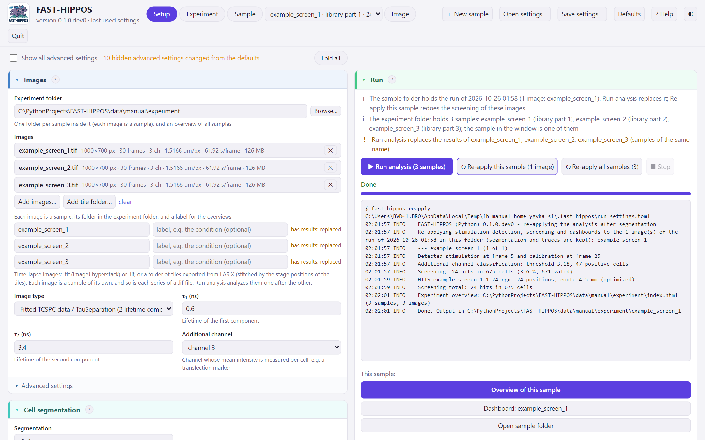
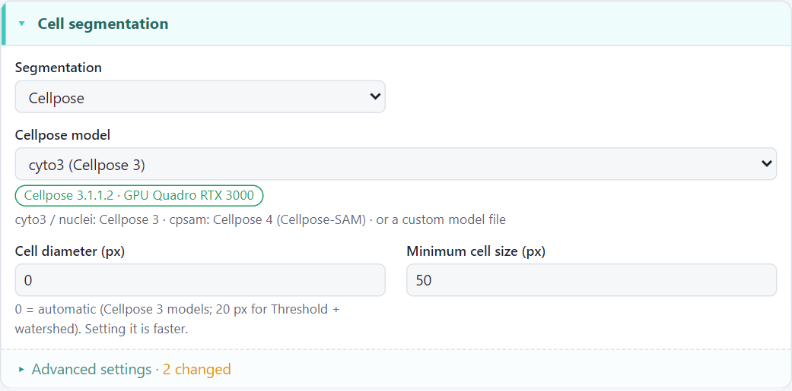
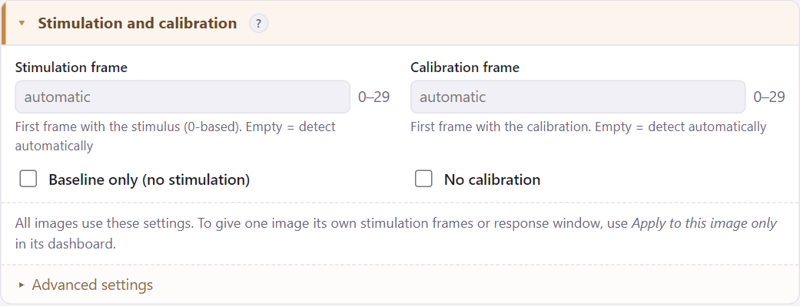
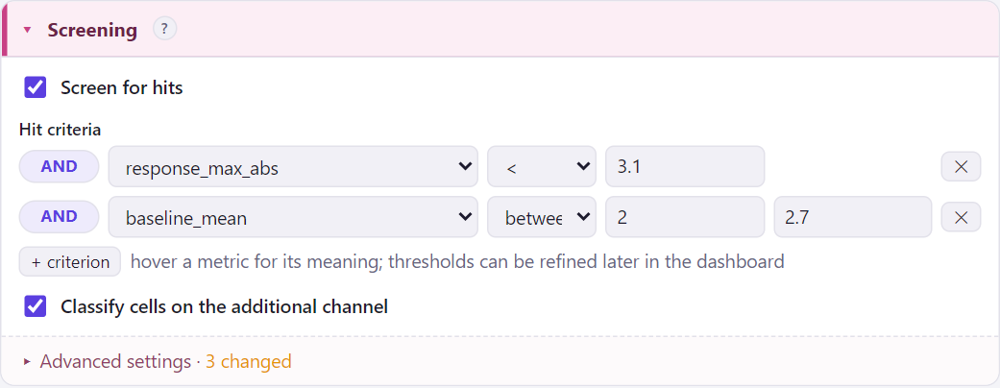
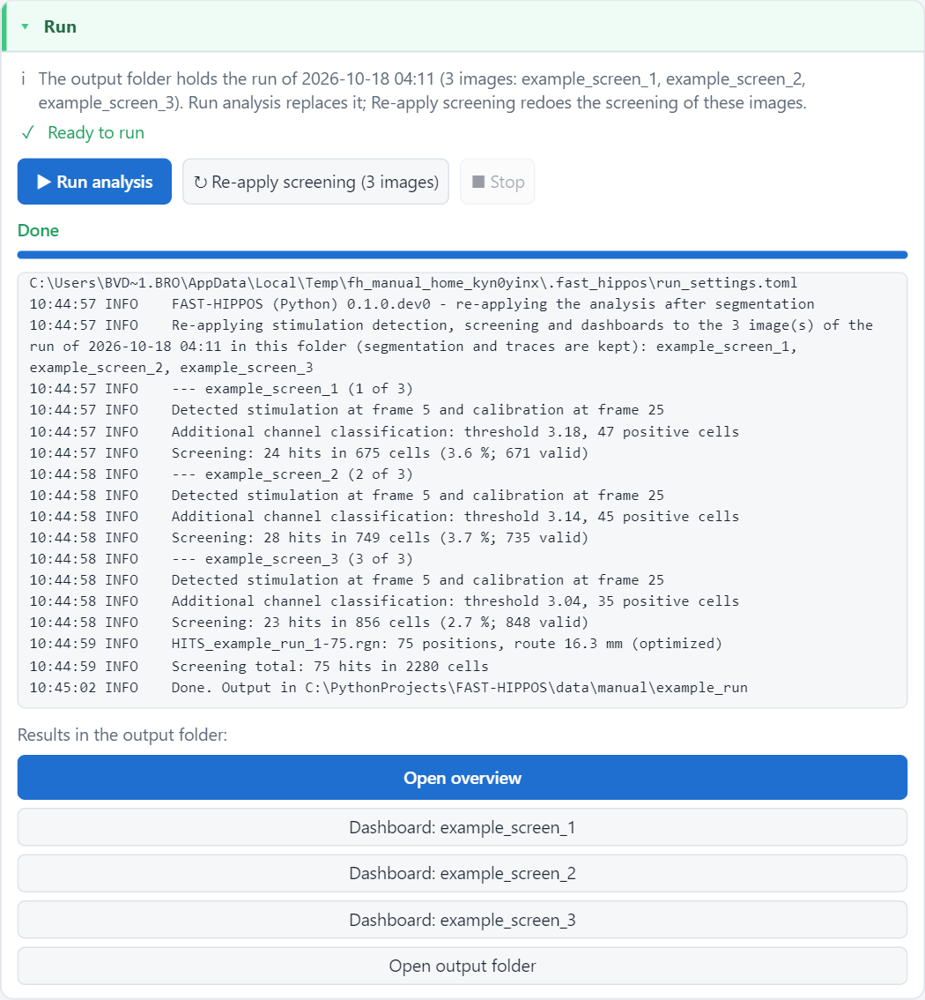
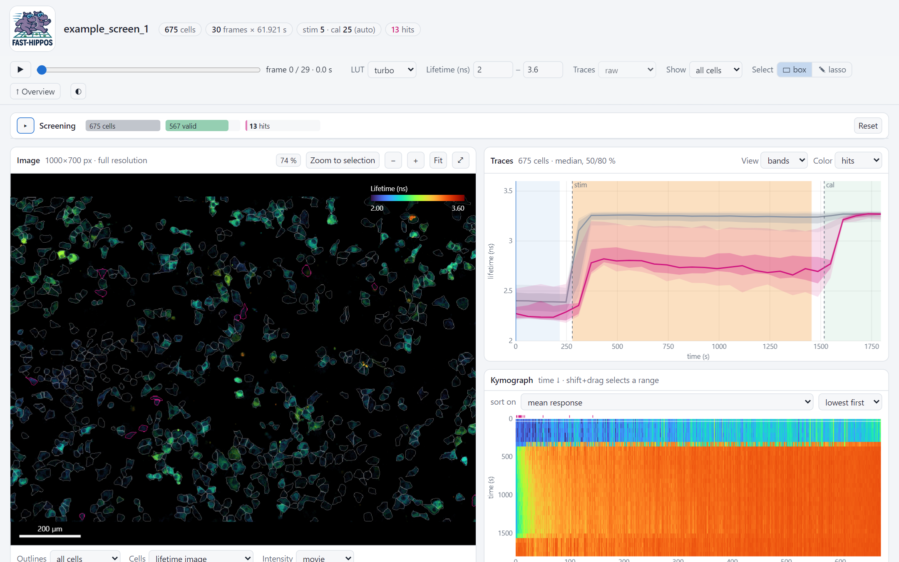

# Your first analysis

This walk-through analyzes the example data from start to finish, in about ten minutes. You will find the cells,
measure their lifetime traces, pick the cells that respond weakly to the stimulation, and get their stage positions
for the microscope.

## The example data

### What the experiment is about

The example comes from a test of a screen for cAMP signaling, of the kind described in our paper
[*Beyond Static Screens: optical pooled screening of signaling dynamics using time-lapse FLIM*](https://www.biorxiv.org/content/10.1101/2025.07.11.664338v3.full)
(Mukherjee et al., bioRxiv 2025, Fig. 4).

- **The cells** are Cos7 cells with the FRET-FLIM sensor EpacH250, which reports cAMP: when cAMP rises, the
  fluorescence lifetime of the sensor rises.
- **The stimulation** is isoproterenol, which activates the β-adrenergic receptors. In normal (wild-type) cells this
  gives a strong, sustained cAMP response. The **calibration** at the end is forskolin, which activates the adenylyl
  cyclases directly and gives the maximal response in every cell with a working sensor.
- **The mix**: about 5 % of the cells are ADRB2 knock-out cells: they lack the β2-adrenergic receptor, so most of
  them respond weakly or not at all to isoproterenol, but they still respond to forskolin. They were mixed with
  95 % wild-type cells to simulate the rare hits of a real pooled screen.
- **The marker**: before mixing, the knock-out cells were labelled with the photoactivatable dye PA-JF646 (the third
  channel). In a real screen you don't know beforehand which cells are hits; here the marker tells you, so you can
  see how well the hit criterion works.

So in this screen the hits are the **low responders**: cells with a small mean response to isoproterenol, while
they do respond to the calibration. (The paper used the same idea: a mean response lifetime below 3.05 ns in the
frames before the calibration.)

### Download

[Download the example data](https://github.com/Jalink-lab/FAST-HIPPOS-Python/releases/tag/example-data) (a ZIP file)
and unpack it, for instance to `C:\Data\FAST-HIPPOS example`. It holds three images of the same screen and two small
text files:

| File | |
|---|---|
| `example_screen_1.tif` … `example_screen_3.tif` | three fields of a pooled screen, 1000 × 700 pixels, 30 frames of 62 s |
| `stage_positions.txt` | the stage position of each image (normally this is stored in the images themselves) |
| `example_settings.toml` | all settings of this walk-through: *Open settings…* in the window loads them at once |

Each image has three channels: the two amplitude images of a two-component lifetime fit (lifetimes 0.6 and 3.4 ns,
as exported from LAS X), and the PA-JF646 marker of the knock-out cells. Isoproterenol was added in frame 5: the
lifetime of most cells then rises by about 0.8 ns. In frame 25 the forskolin calibration follows. We look for the
few cells that **hardly respond** to isoproterenol.

## 1. Open FAST-HIPPOS

Double-click the FAST-HIPPOS shortcut on the desktop. The window opens in your web browser; it consists of cards
for the settings on the left and the *Run* card on the right.

<figure markdown>
{ .shot }
<figcaption>The FAST-HIPPOS window, here after the analysis of the example: the settings on the left, the checks, the
log and the results on the right.</figcaption>
</figure>

## 2. Images

<figure markdown>
{ .shot width="560" }
</figure>

<ol class="callouts" markdown>
<li markdown>Click **Add images…** and choose the three `example_screen_*.tif` files. Each image shows its size, frames,
channels, pixel size and frame interval, read from the file.</li>
<li markdown>Click **Browse…** next to *Output folder* and choose (or make) an empty folder, e.g.
`C:\Data\FAST-HIPPOS example\example_run`. All results go there.</li>
<li markdown>*Image type*: **Fitted TCSPC data / TauSeparation**, with τ₁ = **0.6** and τ₂ = **3.4** ns: the lifetimes of
the two components of the fit.</li>
<li markdown>*Additional channel*: **channel 3**, the marker. FAST-HIPPOS measures its intensity in every cell.</li>
</ol>

## 3. Cell segmentation

<figure markdown>
{ .shot width="560" }
</figure>

Leave **Cellpose** with the model **cyto3**. The green label shows that FAST-HIPPOS found Cellpose and a GPU. If it
shows a problem instead, see [Installation → Cellpose](install.md#4-cellpose). The cell diameter **0** means that
Cellpose estimates it.

## 4. Stimulation and calibration

<figure markdown>
{ .shot width="560" }
</figure>

Leave both frames empty (*automatic*): FAST-HIPPOS finds the stimulation and the calibration in the average trace
of all cells. You can always correct them later, in the dashboard.

## 5. Screening

<figure markdown>
{ .shot width="560" }
</figure>

1. Tick **Screen for hits**.
2. Click **+ criterion**, choose `response_mean_diff`, **<** and **0.6**. `response_mean_diff` is the average rise of
   the lifetime after the stimulation, compared with the cell's own baseline (hover over the name for its meaning).
   Cells that rise less than 0.6 ns become hits. Don't worry about the exact value: you will
   [fine-tune it in the dashboard](../guide/choosing-hits.md), while you watch the hits change.
3. Tick **Classify cells on the additional channel**: the cells are split into marker-positive and negative cells.

For this example, the images have no stage positions of their own, so open *Advanced settings* of the Screening card
and choose `stage_positions.txt` as *Stage positions file*. With your own LAS X data this is not needed.

## 6. Run

<figure markdown>
{ .shot width="560" }
</figure>

The *Run* card checks the settings against the images all the time. Problems that would stop the analysis are shown
in red and disable the button; warnings in orange point out surprises. When it says **Ready to run**, click
**▶ Run analysis**.

The log shows what happens per image: the number of cells, the frames where the stimulation and calibration were
found, the number of hits. With a GPU this takes about a minute for the three images.

When it is done, the buttons under *Results in the output folder* open the results:

- **Open overview**: all images of the run together, see [the run overview](../guide/overview.md).
- **Dashboard: example_screen_1** etc.: one image in detail, see [the dashboard](../guide/dashboard.md).

## 7. Look at the results

Open the dashboard of `example_screen_1`.

<figure markdown>
{ .shot }
<figcaption>The 13 hits of example_screen_1 are outlined in pink. Their median trace (pink) rises much less than that
of the other cells (grey).</figcaption>
</figure>

Things to try:

- Move the mouse over the cells: the cell under the mouse is highlighted in all views, and the *Cell* card further
  down shows its trace and why it is, or is not, a hit.
- Click **Select hits** and then **Zoom to selection**.
- Press ++space++ to play the time-lapse.
- In the *Screening* pane at the top, drag the threshold of the criterion (the black marker on the histogram): the
  hits change at once, everywhere.

Then open the overview, to compare the three images and see where the hits are.

## 8. To the microscope

The output folder now holds `HITS_example_run_1-29.rgn`: the stage positions of the 29 hits, in an efficient
visiting order. Load it in the LAS X Navigator (right-click → *Load regions*) to revisit the cells; see
[back to the microscope](../guide/microscope.md).

## What next?

- [Choosing the hits](../guide/choosing-hits.md): criteria, quality gates and the response window.
- [The FAST-HIPPOS window](../guide/window.md): all cards, and the settings for other kinds of data.
- [The output folder](../guide/output-folder.md): which files you get, and how to redo the screening without
  segmenting again.
